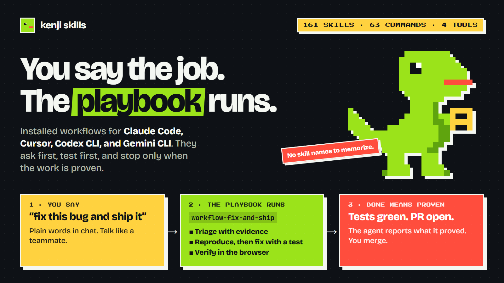
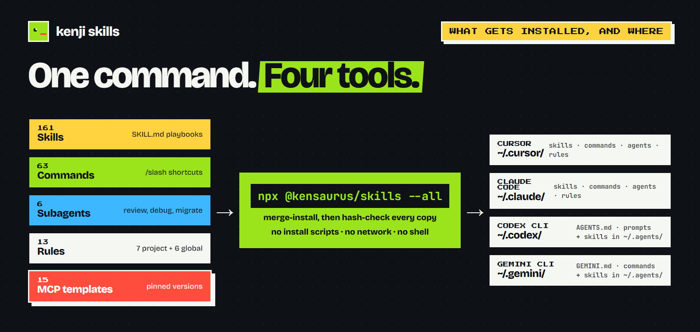
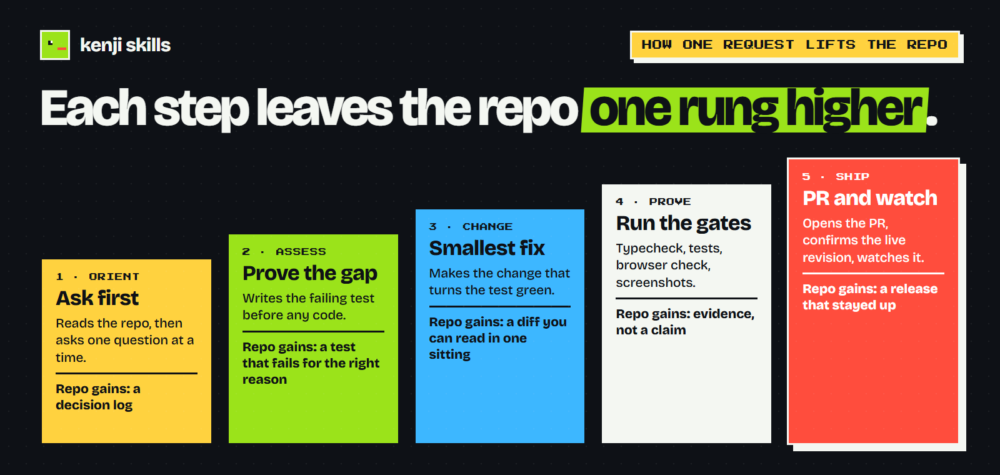
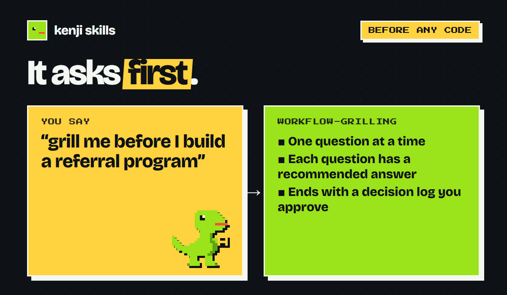
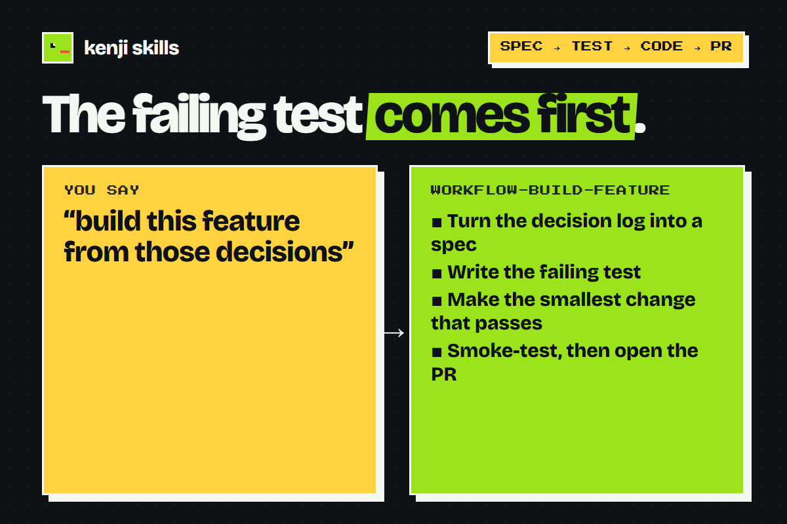
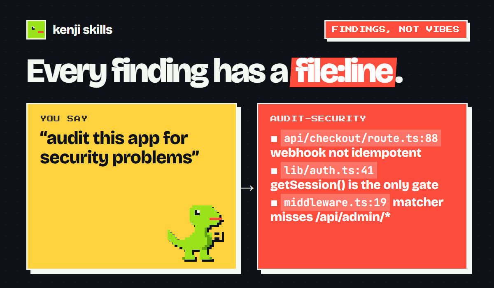
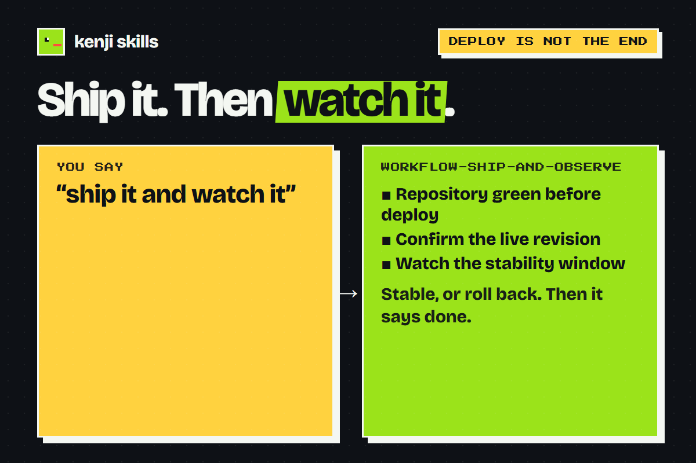
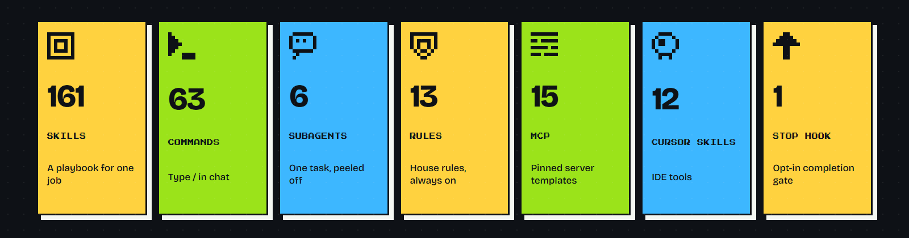

<div align="center">


# kenji skills

**You say the job. The playbook runs.** Agent skills, slash commands, and subagents for Claude Code, Cursor, Codex CLI, Gemini CLI, and any agent that reads `SKILL.md`.

161 agent skills · 63 slash commands · 6 subagents · MCP templates. Written on React, Next.js, and Supabase projects; most of it works on any stack.

<p>
  <a href="https://www.npmjs.com/package/@kensaurus/skills"></a>
  
  
</p>

<a href="docs/GETTING-STARTED.md" title="First-time guide">
  <picture>
    <source media="(prefers-color-scheme: dark)" srcset="docs/screenshots/hero-dark.png">
    <source media="(prefers-color-scheme: light)" srcset="docs/screenshots/hero-light.png">
    
  </picture>
</a>

<sub>After you install, describe the job in chat. The matching playbook runs, checks its own result, and opens the PR.</sub>

</div>

##  Quickstart

You need [Node.js](https://nodejs.org) 18 or newer. Run these three commands:

```bash
npx @kensaurus/skills --auto --dry-run   # 1. preview: lists every file it would write, changes nothing
npx @kensaurus/skills --auto             # 2. install for each agent found on this machine
npx @kensaurus/skills --auto --verify    # 3. check every installed file against the package
```

`--auto` looks for `~/.cursor`, `~/.claude`, `~/.codex`, and `~/.gemini` and installs for each one it finds. If it finds none, it installs for Cursor. To pick the tools yourself, use `--claude`, `--cursor`, `--codex`, `--gemini` (combine freely) or `--all`.

Then restart your agent and describe a task in plain words, for example *"audit this repo for security problems"*. The [plain-language guide](docs/GETTING-STARTED.md) walks through a first session.

> **Note:** the default install also adds an opt-in **Stop hook** to Claude Code and Cursor. It does nothing until you start a `complete-everything` or `burndown-full` run. To skip it, add `--only skills,commands,agents,rules`. Details: [The Stop hook](#the-stop-hook).

##  Which agents are supported

| Agent | Install with | Skills | Slash commands | Subagents | Rules | Stop hook |
|:------|:-------------|:-------|:---------------|:----------|:------|:----------|
| **Claude Code** | `--claude` | `~/.claude/skills/` | `~/.claude/commands/` | `~/.claude/agents/` | `~/.claude/rules/` (`.md`) | yes, in `~/.claude/settings.json` |
| **Cursor** | bare command or `--cursor` | `~/.cursor/skills/`, plus a copy in `~/.agents/skills/` | `~/.cursor/commands/` | `~/.cursor/agents/` | `~/.cursor/rules/` (`.mdc`; see below) | yes, in `~/.cursor/hooks.json` |
| **Codex CLI** | `--codex` | `~/.agents/skills/` | portable prompts in `~/.codex/prompts/` (see below) | no | merged into `~/.codex/AGENTS.md` | no |
| **Gemini CLI** | `--gemini` | `~/.agents/skills/` | portable commands in `~/.gemini/commands/` | no | merged into `~/.gemini/GEMINI.md` | no |
| **Any agent that reads `SKILL.md`** | `npx skills add kensaurus/skills` | that agent's skills folder | no | no | no | no |

How each path was chosen:

- **Codex CLI** reads user skills from `$HOME/.agents/skills` ([Codex skills docs](https://developers.openai.com/codex/skills), "Where Codex loads local skills"). It reads global instructions from `~/.codex/AGENTS.md` ([AGENTS.md docs](https://learn.chatgpt.com/docs/agent-configuration/agents-md)). Codex has deprecated custom prompts ([custom prompts page](https://learn.chatgpt.com/docs/custom-prompts)), and a Codex maintainer says they were removed in codex-cli 0.117.0 ([openai/codex#15941](https://github.com/openai/codex/issues/15941)). The installer still writes the portable prompts for older Codex releases. On current Codex, use the skills.
- **Gemini CLI** reads user skills from `~/.gemini/skills/` or the `~/.agents/skills/` alias. Within the user tier, the alias takes precedence ([Gemini CLI skills docs](https://geminicli.com/docs/cli/skills/), "Discovery tiers"). It reads global context from `~/.gemini/GEMINI.md` ([GEMINI.md docs](https://geminicli.com/docs/cli/gemini-md)).
- **Codex and Gemini share one copy in `~/.agents/skills/`.** It is written once per run, and other skills already in that folder are left alone, even by `--clean`.
  - With only `--codex` or `--gemini`, the installer writes just this pack's skill folders.
  - When Cursor is also a target, Cursor's mirror fills the folder instead, and the installer reuses that copy. The mirror copies everything in `~/.cursor/skills/`, so your own Cursor skills also become visible to Codex and Gemini. To avoid that, install Cursor in a separate run with `--no-agents-mirror`.
- **Cursor** reads skills from `~/.cursor/skills/`. Its [rules docs](https://cursor.com/docs/rules) describe project rules in a repo's `.cursor/rules/` and user rules in Customize → Rules. They do not mention `~/.cursor/rules/`, where the installer puts the global rules. If a rule does not seem to apply in Cursor, copy the `.mdc` file into your project's `.cursor/rules/`.
- **Claude Code** loads every file in `~/.claude/rules/` in every project, except rules with a `paths:` field, which load only when matching files are open ([Claude Code memory docs](https://code.claude.com/docs/en/memory)).
- **Other agents.** The [skills CLI](https://github.com/vercel-labs/skills) copies `SKILL.md` folders into the folder each agent reads, for example GitHub Copilot, OpenCode, or Antigravity CLI. Pass `-g` for your user folder and `-a <agent-id>` for the agent. The IDs are in the skills CLI README under "Supported Agents". Example: `npx skills add kensaurus/skills -g -a github-copilot`. You get the skills in `skills/` only, without commands, subagents, rules, or the hook.
- **Claude Code plugin.** Instead of the installer, you can run `/plugin marketplace add kensaurus/skills` and then `/plugin install kenji@kenji`.

<picture>
  <source media="(prefers-color-scheme: dark)" srcset="docs/screenshots/architecture-dark.png">
  <source media="(prefers-color-scheme: light)" srcset="docs/screenshots/architecture-light.png">
  
</picture>

## What the installer writes

The installer is one Node script, [`bin/install.mjs`](bin/install.mjs). It has no dependencies or npm lifecycle scripts. It opens no network connection and starts no child processes; `npx` downloads the package before it runs. It writes only under your home directory:

| Path | What | When it exists already |
|:-----|:-----|:-----------------------|
| `~/.cursor/skills/<name>/`, `~/.claude/skills/<name>/` | One folder per skill | Same-named files are overwritten. Your other skills stay. |
| `~/.agents/skills/<name>/` | Skills for Codex and Gemini, and Cursor's mirror (which copies all of `~/.cursor/skills/`, yours included) | Same as above. Skip it with `--no-agents-mirror`, which also means Codex and Gemini get no skills. |
| `~/.cursor/commands/`, `~/.claude/commands/` | Slash commands (`.md`) | Same-named files are overwritten. |
| `~/.cursor/agents/`, `~/.claude/agents/` | Subagent definitions | Same-named files are overwritten. |
| `~/.cursor/rules/`, `~/.claude/rules/` | Global rules (`.mdc` for Cursor, `.md` for Claude Code) | Same-named files are overwritten. |
| `~/.codex/AGENTS.md`, `~/.gemini/GEMINI.md` | Global rules merged into one file | The old file is copied to `<file>.bak-<timestamp>` first. An unchanged file is not rewritten. |
| `~/.codex/prompts/*.md`, `~/.gemini/commands/*.toml` | `plan-mode`, `research`, `fix-issue` | Backed up like `AGENTS.md`. |
| `~/.claude/kenji-hooks/`, `~/.cursor/kenji-hooks/` | `completion-gate.mjs`, the Stop hook script | Overwritten. |
| `~/.claude/settings.json`, `~/.cursor/hooks.json` | One Stop hook entry | Merged. Your other settings and hooks are kept. A backup is written when the file changes. If the file is not valid JSON, the hook is skipped with a warning. |
| `~/.cursor/mcp.json` | MCP server template | Written only if missing. Never overwritten. |

A normal run **merges**: it adds or overwrites this pack's files and never deletes your own. It also removes leftovers that this pack itself renamed or stopped installing. After every write, the installer hash-checks each copied file.

**`--clean` is different.** It deletes the whole `skills/`, `commands/`, `agents/`, and `rules/` folders under each targeted `~/.cursor` and `~/.claude`, **your own files in them included**, and then installs fresh. It first copies those folders to `<base>/.kenji-backups/<timestamp>/`, unless you pass `--no-backup`. It does not touch `AGENTS.md`, `GEMINI.md`, or the Codex and Gemini command files. In `~/.agents/skills/` it removes only this pack's skill folders.

<details>
<summary><b>All installer flags</b></summary>

```bash
npx @kensaurus/skills                   # Cursor only (the default)
npx @kensaurus/skills --auto            # every tool found under ~ (falls back to Cursor)
npx @kensaurus/skills --all             # Cursor + Claude Code + Codex CLI + Gemini CLI
npx @kensaurus/skills --claude --codex  # pick targets; combine freely
npx @kensaurus/skills --only skills,commands      # subset of: skills, commands, agents, rules, hooks
npx @kensaurus/skills --skill audit-ux  # one skill
npx @kensaurus/skills --dry-run         # preview, no writes
npx @kensaurus/skills --verify          # read-only hash check (add the same target flags)
npx @kensaurus/skills --clean           # delete skills/commands/agents/rules folders first, yours too (backed up)
npx @kensaurus/skills --restore [stamp] # put a --clean backup back (latest if no stamp)
npx @kensaurus/skills --link            # symlink instead of copy, for editing skills in a clone
npx @kensaurus/skills --no-agents-mirror  # write nothing to ~/.agents/skills
npx @kensaurus/skills --help            # full help
```

From a clone, `./install.sh` with no arguments installs for Cursor and Claude Code. With arguments, it passes them to `node bin/install.mjs`.

</details>

### The Stop hook

The completion gate, [`hooks/completion-gate.mjs`](hooks/completion-gate.mjs), is registered as a Stop hook in Claude Code and Cursor. It reads the open workspace for `.cursor/complete-everything-state.md` or `.cursor/burndown-state.md`. Those files exist only during a `complete-everything` or `burndown-full` run. If neither file exists, or the checklist was last updated more than a day ago, the hook exits without doing anything. Otherwise it sends the agent back to the unfinished items instead of letting it stop. After three follow-ups with no item closed, it gives up. Each run has a 5-second timeout and does not block the agent if it fails.

- **Skip it at install time:** `npx @kensaurus/skills --all --only skills,commands,agents,rules`. Any `--only` also skips the `mcp.json` template.
- **Remove it later:** delete the entry whose command contains `kenji-hooks/completion-gate.mjs` from `hooks.Stop` in `~/.claude/settings.json` and from `hooks.stop` in `~/.cursor/hooks.json`. Then delete `~/.claude/kenji-hooks/` and `~/.cursor/kenji-hooks/`. A later install without `--only` adds it back.

### The stack-specific parts, and how to skip them

These skills and rules were written on React, Next.js, and Supabase projects. Here is what assumes that stack:

| Piece | What it assumes | Loads when |
|:------|:----------------|:-----------|
| `rules/senior-engineer.mdc` | Next.js + React + Supabase defaults: TanStack Query, Zustand, Zod, RLS on every table | Claude Code: only with files under `app/`, `supabase/`, or `next.config.*` open (its `paths:` field). Cursor: when the agent judges its description relevant. Codex and Gemini: every session, because it is merged into `AGENTS.md` / `GEMINI.md`. |
| `rules/full-stack-ship-discipline.mdc` | Deploy schema with the feature; uses Supabase as the worked example | Claude Code, Codex, Gemini: every session (no `paths:` field). Cursor: when the agent judges its description relevant. |
| `rules/project-starter/`, `rules/native-rn-monorepo/` | Per-project rule sets for Next.js/Supabase and React Native | Never installed. Copy them into a project yourself. |
| Skills such as `plan-rls-audit`, `backend-realtime`, `mushi-*` | The tool in their name or description | Only when your request matches |

The other global rules (`verification-before-completion`, `approved-plan-execution`, `shell-first-search`, `skill-workflows`) do not depend on a stack.

To install without the global rules: `npx @kensaurus/skills --all --only skills,commands,agents`. This also skips the Stop hook and the MCP template. To drop a single rule, delete its file after installing. A later install without `--only` puts it back.

##  Verify, update, uninstall

**Verify.** `npx @kensaurus/skills --verify` plus the target flags you installed with (`--auto`, `--all`, `--codex`, …). It makes no changes. It fails if a packaged file is missing or differs from the package, and lists each one. Extra files of your own are allowed. Line endings are normalized before hashing, so CRLF copies on Windows still match.

**Update.** Run the same install command again. Unchanged files are left as they are, and renamed skills from older releases are removed.

**Roll back.**
- `--clean` runs keep a backup. Restore it with `npx @kensaurus/skills --restore` (Cursor) or `--restore --claude`, plus a stamp from `.kenji-backups/` to pick an older one.
- `AGENTS.md`, `GEMINI.md`, `settings.json`, `hooks.json`, and the Codex/Gemini command files keep `.bak-<timestamp>` copies next to them. Copy one back by hand.
- A normal merge does **not** back up skill, command, agent, or rule files it overwrites. If you edited one of this pack's files in place, copy it somewhere first.

**Uninstall.** There is no uninstall command. Remove the pieces by hand:

```bash
# Skills, commands and agents this pack ships (bash; uses a fresh clone for the names)
git clone --depth 1 https://github.com/kensaurus/skills.git /tmp/kenji
for d in /tmp/kenji/skills/*/ /tmp/kenji/skills-cursor/*/; do
  n=$(basename "$d"); rm -rf ~/.cursor/skills/"$n" ~/.claude/skills/"$n" ~/.agents/skills/"$n"
done
for f in /tmp/kenji/commands/*.md; do rm -f ~/.cursor/commands/"$(basename "$f")" ~/.claude/commands/"$(basename "$f")"; done
for f in /tmp/kenji/agents/*.md;   do rm -f ~/.cursor/agents/"$(basename "$f")"   ~/.claude/agents/"$(basename "$f")"; done
```

Then remove what is left:
- the global rules listed in [Rules](#commands-subagents-mcp-rules), from `~/.cursor/rules/` and `~/.claude/rules/`;
- the Stop hook, as described in [The Stop hook](#the-stop-hook);
- `~/.codex/AGENTS.md` and `~/.gemini/GEMINI.md` (or restore a `.bak-` copy);
- the `plan-mode`, `research`, and `fix-issue` files in `~/.codex/prompts/` and `~/.gemini/commands/`.

Leave `~/.cursor/mcp.json` alone if you have edited it. To remove the Claude Code plugin, run `claude plugin uninstall kenji@kenji` ([docs](https://code.claude.com/docs/en/plugins/cli-reference#plugin-uninstall)). To remove skills installed by the skills CLI, run `npx skills remove`.

## Troubleshooting

<details>
<summary><b>Windows: <code>EPERM</code> or <code>EBUSY</code> during install</b></summary>

Another program is holding a file, usually an open editor watching `~/.cursor` or `~/.claude`, or an antivirus scan. The installer retries each file for about 3 seconds, then stops and names the file. Close the editor and run the command again; a merge install is safe to repeat.

</details>

<details>
<summary><b>Windows: line endings (CRLF)</b></summary>

`--verify` normalizes CRLF to LF before hashing text files, so a checkout made with `core.autocrlf=true` verifies cleanly. The repo's `.gitattributes` checks text files out with LF. If `./install.sh` still fails with `$'\r': command not found`, the script was checked out with CRLF line endings: clone again, or run `node bin/install.mjs` with the same arguments. `install.sh` needs bash (Git Bash or WSL); the Node installer does not.

</details>

<details>
<summary><b>"I already have skills, rules, or settings in those folders"</b></summary>

A merge install keeps them. It only overwrites files with the same name as one of this pack's files. Run `--dry-run` first to see the exact list. Hook config files are merged entry by entry, and a backup is written when they change. To keep your own `AGENTS.md` / `GEMINI.md` instead of the merged one, install Codex or Gemini with `--only skills,commands` (or `--only skills`).

</details>

<details>
<summary><b>Codex shows only some skills, or shortened descriptions</b></summary>

Codex lists skills within a budget: 2% of the model's context window, or 8,000 characters when the window is unknown. With many skills installed, it shortens descriptions first and may leave some skills out with a warning ([Codex skills docs](https://developers.openai.com/codex/skills)). To install fewer skills, use `--codex --skill <name>` once per skill. To turn one off, add `[[skills.config]]` with `enabled = false` in `~/.codex/config.toml`. Claude Code has a similar listing budget; the installer prints its current size after a `--claude` install.

</details>

<details>
<summary><b>Codex: the <code>/prompts:</code> commands are missing</b></summary>

Current Codex releases no longer load `~/.codex/prompts/` (see the links in [Which agents are supported](#which-agents-are-supported)). Use the skills instead: type `$` or run `/skills`.

</details>

<details>
<summary><b>Codex: I set <code>CODEX_HOME</code></b></summary>

The installer always writes `~/.codex/AGENTS.md` and `~/.codex/prompts/`. Copy them into your `CODEX_HOME`. Codex reads `AGENTS.override.md` instead of `AGENTS.md` when that file exists, so check for one. Skills are not affected; Codex reads `$HOME/.agents/skills` either way.

</details>

<details>
<summary><b>Gemini CLI asks before a skill runs</b></summary>

That is how Gemini CLI works: activating a skill asks for consent and grants the skill's folder read access ([docs](https://geminicli.com/docs/cli/skills/)). In a running session, `/skills reload` picks up new skills and `/memory reload` re-reads `GEMINI.md`. The same page says Gemini CLI was replaced by Antigravity CLI for unpaid-tier and Google One users on June 18, 2026. This installer does not target Antigravity CLI. The skills CLI lists an `antigravity-cli` agent ID.

</details>

<details>
<summary><b>A skill does not trigger</b></summary>

Skills are matched against what you say. Name the skill to force it, for example *"use `audit-security` on this repo"*, or call it directly: `/audit-security` in Claude Code and Cursor, `$audit-security` in Codex. Trigger phrases for every skill: [docs/CATALOG.md](docs/CATALOG.md).

</details>

##  How one request lifts the repo

<picture>
  <source media="(prefers-color-scheme: dark)" srcset="docs/screenshots/ladder-dark.png">
  <source media="(prefers-color-scheme: light)" srcset="docs/screenshots/ladder-light.png">
  
</picture>

Every playbook follows the same five steps. It assesses before it changes anything, and proves the result before it ships.

| Rung | What runs | What the repo gains |
|:-----|:----------|:--------------------|
| **Orient** | `workflow-onboard`, `/research` | A decision log |
| **Assess** | `audit-*`, `plan-*`, `/grill-me` | A failing test, or a plan you approve |
| **Change** | `design-*`, `enhance-*`, `backend-*`, `housekeep-*` | A diff you can read in one sitting |
| **Prove** | `test-*`, `complete-everything`, `completion-judge` | Evidence, not a claim |
| **Ship** | `workflow-ship-and-observe`, `deploy-*`, `debug-*` | A release that stayed up |

The 23 `plan-*` skills audit first and wait for your approval. See [docs/PLAN-LOOPS.md](docs/PLAN-LOOPS.md).

##  What should I say?

| You say… | What kicks in | What you get |
|:---------|:--------------|:-------------|
| *"orient me"* | `workflow-onboard` | A short tour of the codebase |
| *"grill me before I build"* | `workflow-grilling` | One question at a time until you're aligned |
| *"build this feature"* | `workflow-build-feature` | Spec → tests → code → smoke → PR |
| *"fix this bug and ship it"* | `workflow-fix-and-ship` | Debug → fix → verify → PR → deploy |
| *"this mobile app feels like a website"* | `enhance-mobile-native-feel` | Native chrome, haptics, motion, lists, in one pass |
| *"fix our mobile UI/UX end to end"* | `workflow-mobile-native-uiux` | Native pass → accessibility → device QA → PR |
| *"audit my security"* | `audit-security` | OWASP-style findings with file:line |
| *"is this production-ready?"* | `audit-resilience` + `audit-realworld` | Timeouts, retries, parity checks |
| *"complete everything"* | `complete-everything` | No parked leftovers; a judge verifies "done" |
| *"ship it and watch it"* | `workflow-ship-and-observe` | Deploy → verify live → observe / rollback |
| *"take this to market"* | `workflow-gtm` | GTM plan → approve → analytics, hero, onboarding, SEO, launch kit |

To force a skill: *"use `enhance-web-ux` on `/dashboard`"*. Every trigger phrase → [docs/CATALOG.md](docs/CATALOG.md).

##  Tour

Four examples. Each time, you describe the job and a named playbook runs.

<table>
  <tr>
    <td width="50%" align="center">
      <a href="docs/GETTING-STARTED.md#a-typical-session">
        
      </a>
      <br>
      <sub><b>Grill</b> · <code>workflow-grilling</code> asks one question at a time. You approve a decision log before any code.</sub>
    </td>
    <td width="50%" align="center">
      <a href="docs/CATALOG.md#workflow-build-feature">
        
      </a>
      <br>
      <sub><b>Build</b> · <code>workflow-build-feature</code> writes the spec and the failing test first. Then the code, then the PR.</sub>
    </td>
  </tr>
  <tr>
    <td width="50%" align="center">
      <a href="docs/CATALOG.md#audit-security">
        
      </a>
      <br>
      <sub><b>Audit</b> · <code>audit-security</code> reports each finding with a file and line.</sub>
    </td>
    <td width="50%" align="center">
      <a href="docs/CATALOG.md#workflow-ship-and-observe">
        
      </a>
      <br>
      <sub><b>Ship</b> · <code>workflow-ship-and-observe</code> confirms the live revision, watches the window, and rolls back if it breaks.</sub>
    </td>
  </tr>
</table>

##  What's inside

<picture>
  <source media="(prefers-color-scheme: dark)" srcset="docs/screenshots/pieces-dark.png">
  <source media="(prefers-color-scheme: light)" srcset="docs/screenshots/pieces-light.png">
  
</picture>

- **Skills** start from a plain request.
- **Commands** start with `/`.
- **Subagents** take one task in a separate context.
- **Rules** are standing instructions the agent loads.
- **MCP templates** pin exact server versions against [package-hallucination attacks](https://labs.cloudsecurityalliance.org/research/csa-research-note-slopsquatting-ai-supply-chain-20260419-csa/).

`skills-cursor/` holds Cursor's own built-in skills, ported so Claude Code can use them. The installer gives them to Claude Code only, because Cursor already ships them. Every skill follows the [Agent Skills spec](https://agentskills.io/specification), and `npm test` checks all of them on every change.

<!-- SKILL-INDEX:START -->

#### Skill families at a glance

| Family | Count | In one sentence |
|:-------|------:|:----------------|
| [Audit — inspect; some then fix](docs/SKILLS.md#audit-inspect-some-then-fix-32) | **32** | Check the codebase: security, UX, analytics, IAP, the skill pack |
| [Plan — audit first, change only after you approve](docs/SKILLS.md#plan-audit-first-change-only-after-you-approve-23) | **23** | Write a fix plan you approve before any code changes |
| [Enhance — improve what already exists](docs/SKILLS.md#enhance-improve-what-already-exists-23) | **23** | Polish UI, forms, motion, SEO, PWA, email deliverability |
| [Design — build something new](docs/SKILLS.md#design-build-something-new-10) | **10** | Create new UI, APIs, emails, themes from scratch |
| [Backend — server & data patterns](docs/SKILLS.md#backend-server-data-patterns-5) | **5** | Auth, caching, queues, realtime, observability |
| [Mobile — React Native / Capacitor](docs/SKILLS.md#mobile-react-native-capacitor-5) | **5** | RN screens, emulators, Capacitor, App Store prep |
| [Data — charts & pipelines](docs/SKILLS.md#data-charts-pipelines-2) | **2** | Charts, dashboards, ETL / cron jobs |
| [Docs — write it down clearly](docs/SKILLS.md#docs-write-it-down-clearly-6) | **6** | READMEs, PRDs, RFCs with a reader-first voice |
| [Housekeeping — consolidate or clear one drifted register](docs/SKILLS.md#housekeeping-consolidate-or-clear-one-drifted-register-5) | **5** | Consolidate one drifted register (gates, backlog, design tokens, dead code) |
| [Workflows — multi-step recipes](docs/SKILLS.md#workflows-multi-step-recipes-22) | **22** | End-to-end recipes (build, fix, ship, green the repo) |
| [Test & QA — prove it works](docs/SKILLS.md#test-qa-prove-it-works-8) | **8** | Unit, Playwright, visual regression, load, red-team |
| [Deploy — ship & verify](docs/SKILLS.md#deploy-ship-verify-2) | **2** | npm release + post-deploy smoke tests |
| [Debug — find & fix what's broken](docs/SKILLS.md#debug-find-fix-whats-broken-3) | **3** | Errors, Sentry, frontend-backend mismatches |
| [Iterate — close the loop after launch](docs/SKILLS.md#iterate-close-the-loop-after-launch-3) | **3** | Post-launch feedback loops and agent-harness iteration |
| [Mushi Mushi — bug triage helpers](docs/SKILLS.md#mushi-mushi-bug-triage-helpers-2) | **2** | Integrate the Mushi Mushi bug-report pipeline |
| [Protocols — session guardrails](docs/SKILLS.md#protocols-session-guardrails-1) | **1** | Keep browser automation from freezing |
| [Authoring — build skills & MCP](docs/SKILLS.md#authoring-build-skills-mcp-2) | **2** | Author new skills or MCP servers |
| [Third-party (upstream-maintained)](docs/SKILLS.md#third-party-upstream-maintained-3) | **3** | Vendored upstream skills (Emil, UI/UX Pro Max, Vercel WIG) |
| [Core & cross-cutting](docs/SKILLS.md#core-cross-cutting-4) | **4** | Close everything, burndown, research, handoff |
| [Cursor IDE skills](docs/SKILLS.md#cursor-ide-skills-12) | **12** | Canvas, hooks, rules, PR splitter, CLI helpers |
| **Total** | **173** | [Every skill, one line each](docs/SKILLS.md) |

_Generated from each skill's `SKILL.md` by `npm run gen:skill-index`. **173 skills.** The full list is [docs/SKILLS.md](docs/SKILLS.md); trigger phrases are in [docs/CATALOG.md](docs/CATALOG.md)._

<!-- SKILL-INDEX:END -->

##  Commands, subagents, MCP, rules

<details>
<summary><b>Commands</b>: type <code>/</code> in chat to see them all</summary>

There are 63 slash commands. Claude Code and Cursor get all of them. Codex and Gemini get the portable ones in `commands-portable/`.

| Command | When | What |
|:--------|:-----|:-----|
| `/burndown-full` | A refactor stopped early | Drive the plan to 100% repo coverage with a verification gate |
| `/complete-everything` | A plan marked done with deferrals | Close planned, parked, and discovered work; run the test ladder |
| `/green-repo` | Whole-repo debt cleanup | Drive typecheck, lint, test, and build to green |
| `/ship-and-observe` | Deploy to production | Verify the live revision, watch the window, roll back if needed |
| `/feedback-to-closure` | Reports, QA, Sentry | Dedupe into tickets, fix, verify in production |
| `/plan-mode` | Before coding | Research + approved plan (`/plan` is the host mode switch) |
| `/commit` · `/pr` · `/fix-issue [#]` | Git flow | Lint and commit · push and open PR · issue to fix to PR |
| `/debug-issue` · `/review-code` · `/test` | Quality | Runtime evidence · review · route to the matching test skill |
| `/research` · `/readme` · `/refactor` · `/update-deps` | Maintenance | Doc research · README sync · modular split · safe dep updates |
| `/uiux` · `/readability` · `/responsive-audit` · `/instant-nav` | UI | Design system · reading load · breakpoints · instant navigation |
| `/deadcode` | Unused files, exports, deps | Knip baseline, then delete by category behind a shrink-only ratchet |
| `/gtm` · `/gtm-weekly` · `/launch-kit` | Growth | GTM plan and loop · weekly review · launch copy from verified claims |
| `/skill-conflicts` · `/mcp-guide` | Pack hygiene | Overlapping triggers · MCP tool reference |
| `/*-plan` (23 aliases) | Audit before changing | Thin pointers to the `plan-*` skills; audit and plan only |

RN monorepo bundle: copy `commands/native-rn-monorepo/` and `rules/native-rn-monorepo/` into your project (iOS builds on CI). Full command list → [docs/CATALOG.md](docs/CATALOG.md).

</details>

<details>
<summary><b>Subagents</b>: Claude Code and Cursor</summary>

There are 6 subagents:

| Agent | Triggers on | Output |
|:------|:------------|:-------|
| `code-reviewer` | "review", code changes | Quality, security, types |
| `debugger` | Errors, exceptions | Root cause + fix |
| `db-migrator` | "migration", "new table" | SQL, RLS, indexes |
| `deploy-checker` | "deploy", "ship it" | Pre-deploy validation |
| `perf-monitor` | "slow", "optimize" | Perf audit |
| `completion-judge` | A closure claim | PASS / CONTINUE / BLOCKED against plan, state, diff, and fresh evidence |

</details>

<details>
<summary><b>MCP server templates</b></summary>

```bash
cp ~/skills/mcp/mcp.json.template ~/.cursor/mcp.json      # essential 3
cp ~/skills/mcp/mcp-full.json.template ~/.cursor/mcp.json  # every server below
```

The installer writes the essential template to `~/.cursor/mcp.json` only when that file does not exist. Set `FIRECRAWL_API_KEY`, `CONTEXT7_API_KEY`, `SUPABASE_ACCESS_TOKEN`, and `SUPABASE_PROJECT_REF` in your environment. The Slack and Notion entries in the full template still use `YOUR_*` placeholders. Never commit real keys ([SECURITY.md](SECURITY.md)). Setup → [mcp/README.md](mcp/README.md).

| Tier | Servers | Keys? |
|:-----|:--------|:------|
| Essential | Firecrawl, Context7, Supabase | Firecrawl + Context7 + Supabase |
| Dev | GitHub, GitHub Official, Playwright, Postgres, Memory, Chrome DevTools | PAT / conn string |
| Cloud | AWS Lambda, S3, CloudWatch, Redis | AWS profile / URL |
| Productivity | Slack, Notion | Bot token / API key |

</details>

<details>
<summary><b>Rules: global and per-project</b></summary>

Global rules the installer writes: `verification-before-completion.mdc` (always on), `approved-plan-execution.mdc`, `full-stack-ship-discipline.mdc`, `senior-engineer.mdc`, `shell-first-search.mdc`, `skill-workflows.mdc`. Codex and Gemini get all of them merged into one file, except `skill-workflows`. Stack assumptions and how to skip them: [The stack-specific parts](#the-stack-specific-parts-and-how-to-skip-them). Model and effort routing: [docs/MODEL-AND-EFFORT.md](docs/MODEL-AND-EFFORT.md).

Per-project rules for a Next.js + Supabase app are never installed globally. Copy them in yourself:

```bash
cp ~/skills/rules/project-starter/*.mdc your-project/.cursor/rules/
```

| Rule | Enforces |
|:-----|:---------|
| `supabase.mdc` | Typed clients, RLS, migrations |
| `typescript.mdc` | No `any`, Zod, ActionResult |
| `components.mdc` | Primitives, Server Components, a11y |
| `tailwind.mdc` | Tokens, mobile-first |
| `data-fetching.mdc` | TanStack Query, RSC prefetch, `'use cache'` |
| `web-performance.mdc` | LCP priority, INP yield, bfcache, budgets |
| `git.mdc` | Conventional commits, no secrets |

**Project constitution:** copy [docs/AGENTS.template.md](docs/AGENTS.template.md) into your app repo as `AGENTS.md`.

Plan → apply pairs: `plan-uiux-unification` → `housekeep-design`; `plan-dead-code` → `housekeep-dead-code`; `plan-gtm` → `workflow-gtm`. The plan half audits and stops. The apply half changes the repo only against a list you approved. Third-party skills are prefixed `thirdparty-*` and carry an `ATTRIBUTION.md` → [docs/THIRD-PARTY-SKILLS.md](docs/THIRD-PARTY-SKILLS.md).

</details>

<details>
<summary><b>Shell helpers and repository layout</b></summary>

```bash
source ~/skills/shell-aliases/cursor-helpers.sh
```

`newskill <name>` · `lsskills` · `cursor-sync` · `cursor-dev` · `newrule <name>` · `newagent <name>` · `gc <type> <msg>` · `gp`. Definitions in [shell-aliases/cursor-helpers.sh](shell-aliases/cursor-helpers.sh) (clone only).

```
skills/
├── skills/             # 161 Agent Skills (SKILL.md each)
├── skills-cursor/      # Cursor's built-in skills, ported for Claude Code
├── commands/           # 63 slash commands
├── commands-portable/  # commands ported to Codex and Gemini
├── agents/             # 6 subagents
├── hooks/              # opt-in completion Stop hook
├── rules/              # global rules + per-project bundles
├── mcp/                # MCP templates and pinned versions
├── docs/               # SKILLS, CATALOG, PLAN-LOOPS, GETTING-STARTED, …
├── notepads/           # context templates (clone only)
├── shell-aliases/      # bash helpers (clone only)
├── scripts/            # validators, count and index checks, install tests
└── bin/install.mjs     # the installer
```

</details>

## Upgrading from cursor-kenji

2.0.0 renamed the pack: repo `kensaurus/cursor-kenji` → `kensaurus/skills`, npm `@kensaurus/cursor-kenji` → `@kensaurus/skills`, plugin `cursor-kenji@cursor-kenji` → `kenji@kenji`, slash namespace `/cursor-kenji:` → `/kenji:`. Old GitHub URLs redirect.

<details>
<summary><b>What to run once</b></summary>

| You installed with | Do this once |
|---|---|
| `npx @kensaurus/cursor-kenji` | `npx @kensaurus/skills --all`. The installer moves its Stop hook from `cursor-kenji-hooks/` to `kenji-hooks/` and removes the old copy. |
| `npx skills add kensaurus/cursor-kenji` | `npx skills add kensaurus/skills`. Old installs still update through the GitHub redirect. |
| Claude Code plugin | Existing installs keep loading under the new name. For the clean ID: `/plugin marketplace remove cursor-kenji`, `/plugin marketplace add kensaurus/skills`, `/plugin install kenji@kenji`. |
| A clone | `git remote set-url origin https://github.com/kensaurus/skills.git` |

`CURSOR_KENJI_GATE_STATE_DIR` and `CURSOR_KENJI_DIR` still work; the new names are `KENJI_GATE_STATE_DIR` and `KENJI_SKILLS_DIR`.

</details>

##  FAQ

<details>
<summary><b>How do skills trigger? How do I force one?</b></summary>

You talk normally. The agent matches your words against each skill's `description`. To force one, name it: *"use `audit-security` on this repo"*. Full trigger list: [docs/CATALOG.md](docs/CATALOG.md).

</details>

<details>
<summary><b>What is the difference between <code>audit-*</code> and <code>plan-*</code>?</b></summary>

`audit-*` skills report findings and stop, unless the skill says it fixes what it finds (`audit-responsive`, `audit-code-quality`, `audit-performance`, `audit-security`, `audit-i18n`, `audit-bundle-size`, `audit-agent-speed`). `plan-*` skills only write a `plan-{name}.md` burndown, and you approve each phase before any code changes. See [docs/PLAN-LOOPS.md](docs/PLAN-LOOPS.md).

</details>

<details>
<summary><b>How many skills, and where do the counts come from?</b></summary>

**161** agent skills in `skills/` plus **12** Cursor-specific skills in `skills-cursor/` (**173** total). Cursor, Codex, Gemini, and the skills CLI get the first set. Claude Code gets both sets. Every count in this README comes from the filesystem: `npm run check:skills` fails CI when a number here drifts, and `npm run fix:skills` rewrites it. The family table is generated by `npm run gen:skill-index`.

</details>

<details>
<summary><b>Do I need React, Next.js, or Supabase?</b></summary>

No. See [The stack-specific parts](#the-stack-specific-parts-and-how-to-skip-them) for what assumes that stack and how to leave it out.

</details>

<details>
<summary><b>Where do MCP API keys go? Is there an llms.txt?</b></summary>

Copy `mcp/mcp.json.template` to `~/.cursor/mcp.json` and set the environment variables. Never commit real keys ([SECURITY.md](SECURITY.md), [mcp/README.md](mcp/README.md)). Machine-readable docs: [llms.txt](llms.txt).

</details>

##  Contributing

```bash
mkdir -p skills/my-skill && $EDITOR skills/my-skill/SKILL.md
npm test   # spec validation, counts, index, install tests, dead-code check
```

Each skill must pass [Agent Skills spec](https://agentskills.io/specification) validation (`npm run validate:skills`): `name` matches the folder, `description` is at most 320 characters, and the body is under 500 lines. See [CONTRIBUTING.md](CONTRIBUTING.md), [docs/README.md](docs/README.md), [docs/DISTRIBUTION.md](docs/DISTRIBUTION.md), and [docs/TRIGGER-CHEATSHEET.md](docs/TRIGGER-CHEATSHEET.md). Releases: [docs/PUBLISHING.md](docs/PUBLISHING.md).

## Related

- [agentskills.io](https://agentskills.io): the Agent Skills spec these skills follow
- [skills CLI](https://github.com/vercel-labs/skills) and [skills.sh](https://www.skills.sh/kensaurus/skills): install `SKILL.md` folders into many agents
- [awesome-cursorrules](https://github.com/PatrickJS/awesome-cursorrules): curated rules collections
- [SkillsMP](https://skillsmp.com/creators/kensaurus/cursor-kenji): aggregator listing of this repo

This pack ships skills, slash commands, subagents, rules, and MCP templates in one installable package. Where it is listed → [docs/DISTRIBUTION.md](docs/DISTRIBUTION.md).

## More from KENSAURUS

<table>
  <tr>
    <td width="50%" valign="top">
      
      <b>glot.it</b> · A Thai tutor that talks back.<br>
      <sub><a href="https://apps.apple.com/us/app/glot-it/id6761582648">App Store: glot.it</a> · <a href="https://play.google.com/store/apps/details?id=com.glotit.app">Google Play: glot.it – Learn Thai</a> · <a href="https://kensaur.us/glot-it/?utm_source=github&utm_medium=readme">Web</a></sub>
    </td>
    <td width="50%" valign="top">
      
      <b>yen-yen</b> · Mindful money for two. A kakeibo with no bank login and no ads.<br>
      <sub><a href="https://apps.apple.com/app/id6764548441">App Store: yen-yen – Expense Tracker</a> · <a href="https://play.google.com/store/apps/details?id=app.yenyen">Google Play: yen-yen – Expense Tracker</a> · <a href="https://kensaur.us/yen-yen/?utm_source=github&utm_medium=readme">Web</a></sub>
    </td>
  </tr>
  <tr>
    <td valign="top">
      
      <b>the wanting mind</b> · A free living book on why we want what we want. Read it, hear it, ask it questions.<br>
      <sub><a href="https://apps.apple.com/us/app/the-wanting-mind/id6761361305">App Store: the wanting mind – Living Book</a> · <a href="https://play.google.com/store/apps/details?id=us.kensaur.thewantingmind">Google Play: the wanting mind – Living Book</a> · <a href="https://kensaur.us/the-wanting-mind/?utm_source=github&utm_medium=readme">Web</a></sub>
    </td>
    <td valign="top">
      
      <b>Help Her Take Photo</b> · A pose coach for couple photos. See her camera live on your phone.<br>
      <sub><a href="https://apps.apple.com/app/help-her-take-photo/id6762513666">App Store: Help Her Take Photo</a> · <a href="https://play.google.com/store/apps/details?id=com.kensaurus.helphertakephoto">Google Play: help her take photo – Pose Cam</a> · <a href="https://kensaur.us/help-her-take-photo/?utm_source=github&utm_medium=readme">Web</a></sub>
    </td>
  </tr>
  <tr>
    <td valign="top">
      
      <b>lets-talk</b> · Practice hard conversations before you have them, scored.<br>
      <sub><a href="https://play.google.com/store/apps/details?id=us.kensaur.howtotalktogirls">Google Play: lets-talk – Conversation Coach</a> · <a href="https://talk.kensaur.us/?utm_source=github&utm_medium=readme">Web</a></sub>
    </td>
    <td valign="top">
      
      <b>一人社長 Solo Boss</b> · Accounting that mostly runs itself, for one-person companies in Japan.<br>
      <sub><a href="https://solo-boss.kensaur.us/?utm_source=github&utm_medium=readme">Web</a></sub>
    </td>
  </tr>
  <tr>
    <td valign="top">
      
      <b>Tsumagoi Work&amp;Camp 嬬恋牧場</b> · A bookable mountain campground at 1,444 m, built end to end.<br>
      <sub><a href="https://tsumagoi.kensaur.us/?utm_source=github&utm_medium=readme">Web</a> · <a href="https://www.instagram.com/tsumagoicamp/">Instagram</a> · <a href="https://maps.app.goo.gl/JCNnTfsdQVHCS1FA7">Maps</a></sub>
    </td>
    <td valign="top">
      
      <b>Mushi Mushi</b> · Open-source in-app bug reporting SDK. Bug intel for when the graphs lie.<br>
      <sub><a href="https://www.npmjs.com/package/mushi-mushi">npm</a> · <a href="https://github.com/kensaurus/mushi-mushi">GitHub</a></sub>
    </td>
  </tr>
</table>

All apps on Google Play: [kensaurus developer page](https://play.google.com/store/apps/developer?id=kensaurus). Everything else: [kensaur.us](https://kensaur.us/?view=portfolio&utm_source=github&utm_medium=readme).


---

<p align="center">
  <strong>MIT License</strong> · Apache-2.0 portions noted in <a href="NOTICE">NOTICE</a><br/>
  <em><a href="https://github.com/kensaurus">@kensaurus</a> · <a href="CHANGELOG.md">Changelog</a> · <a href="https://github.com/kensaurus/skills/discussions">Discussions</a></em>
</p>
