# Getting Started with kenji

A short guide for people who have never used agent skills. The playbooks are the same in Claude Code, Cursor, Codex CLI, Gemini CLI, and Antigravity CLI; only how you start one differs a little (see Step 4).

---

## What is this?

**kenji** is not a prompt library. It is a set of installed playbooks for [Cursor](https://cursor.com), Claude Code, Codex CLI, and Gemini CLI. You describe the job in chat — "audit my security", "grill me before I build", "fix this and ship it" — and a named workflow runs: look first, change, prove it, then go live.

---

## The idea in one picture



Three things happen every time:

1. **You say the job** in your own words.
2. **A playbook runs.** A playbook (the files call it a *skill*) is a written procedure the agent follows: what to check first, what to test, what to prove.
3. **You get a result you can check**: a test that passes, a finding with a file and line, a pull request.

You only need to remember one command, `/kenji`. Everything else is optional.

---

## Step 1: Have an AI coding agent

Any of these works: [Claude Code](https://code.claude.com), [Cursor](https://cursor.com), Codex CLI, Gemini CLI, or Antigravity CLI. You also need [Node.js](https://nodejs.org) 18 or newer for the install command.

---

## Step 2: Install kenji

```bash
npx @kensaurus/skills --auto
```

That finds the agents on your machine and installs the playbooks for each one, then checks every copied file. Windows works too. To see what it would write first, add `--dry-run`.

**Want less?** The full pack is 162 skills. `npx @kensaurus/skills --auto --profile core` installs the 31 that cover the daily loop. You can add `web`, `backend`, `mobile`, `growth`, or `maintain` later; `--list-profiles` shows them.

**Skills only** (no `/commands` — Vercel skills CLI, current project by default):

```bash
npx skills add kensaurus/skills
```

Add `-g` to put skills in `~/.cursor/skills`. That CLI's `--all` means “all skills to all agents”, not the same as kenji `--all`.

**Alternative — clone:**

```bash
git clone https://github.com/kensaurus/skills.git
cd skills
./install.sh
```

From a clone you can also run `node bin/install.mjs --all`. Re-check anytime with `npx @kensaurus/skills --verify --all`.

**Claude Code as a plugin** (this repo as a marketplace — not the Anthropic community catalog until they list it):

```
/plugin marketplace add kensaurus/skills
/plugin install kenji@kenji
```

---

## Step 3: Restart your agent

Close and reopen it. The playbooks are now active.

---

## Step 4: Type `/kenji` and the job

```
/kenji I want to add a way for users to invite friends
```

`/kenji` names the one playbook that fits, says in a line what you will get, and runs it. If two playbooks fit, it asks you one question first. With no job after it, `/kenji` shows a short menu.

How to type it in each agent:

| Agent | Type |
|:------|:-----|
| Claude Code, Cursor, Antigravity CLI | `/kenji` and the job |
| Claude Code, installed as a plugin | `/kenji:kenji` and the job |
| Codex CLI | `$kenji` and the job, or pick it from `/skills` |
| Gemini CLI | Say "use the kenji skill" and the job |

That is the whole product. The rest of this page shows what a longer session looks like.

---

## A typical session

The usual failure is the agent building the wrong thing. This loop prevents that.

### 1. Get oriented (new repo only)

```
I'm new to this repo, orient me
```

### 2. Get grilled before any code

```
/grill-me I want to add a referral program
```

The agent interviews you — **one question at a time**, each with a recommended answer:

> *"Should a referral reward fire on signup or on first payment? I'd recommend
> first payment — it prevents signup-farming. Agree?"*

It looks up facts in the codebase and only asks you the decisions. The session ends with a decision log.

### 3. Build from the decisions

```
build the feature from those decisions
```

`workflow-build-feature` takes over: spec → failing test → code → smoke test → PR.

When you ask it to finish a whole plan (`complete everything`), a gate checks the moment the agent tries to stop. This is real output from that gate; only the `agent` line was added:



### 4. Hand off when you stop

```
/handoff finish the referral UI tomorrow
```

You get a compact handoff document saved to your OS temp directory (never inside the repo), and the command prints its path. Tomorrow, paste that path into a fresh chat.

**The rhythm: orient → grill → build → prove → hand off.**

---

## Phrases that work without `/kenji`

You can also describe the task directly. A few phrases that do a lot of work:

| Type this in chat… | What happens |
|:-------------------|:-------------|
| `build a feature: user notifications` | Spec → TDD → implement → smoke → PR |
| `fix this Sentry error and ship it` | Triage → reproduce → fix → verify → PR |
| `is this ready to ship?` | Adversarial test + security + bundle + perf |
| `prepare this for a PR` | Review dirty tree → commit → push → open PR (does not merge) |
| `monkey-test as guest and logged-in, ticket every real bug, then lock a Playwright pass on the worst ones` | Wander twice → tickets → lock the worst bugs |
| `grill me about this plan` | One question at a time until you're aligned |
| `audit my app's security` | OWASP-style findings with file:line |
| `complete everything` | Close the plan — no parked leftovers |

Full phrase list → [TRIGGER-CHEATSHEET.md](TRIGGER-CHEATSHEET.md). Plan loops (approve before edits) → [PLAN-LOOPS.md](PLAN-LOOPS.md).

---

## Updating

```bash
npx @kensaurus/skills --all
npx @kensaurus/skills --verify --all
```

The installer merge-overwrites same-name files and hash-checks them. Extra personal skills are left alone.

Skills-only refresh: `npx skills add kensaurus/skills` (does not update slash commands).

---

## Frequently asked questions

**Do I need to configure anything?**
No, for most skills. Skills that talk to Sentry, Supabase, or Langfuse tell you when they need API keys.

**Will this slow my agent down or cost more?**
A little, and you control it. A playbook's full text loads only when it runs. What rides in every request is a one-line description of each installed skill: about 39,000 characters for the full pack. A profile install (`--profile core`) is a small fraction of that. `/kenji` and `/handoff` are not in that listing at all. See [MODEL-AND-EFFORT.md](MODEL-AND-EFFORT.md).

**Can I remove skills I don't need?**
Yes. `npx @kensaurus/skills --auto --profile core --prune` keeps the core set and removes the rest of this pack's skills, after copying them to a `.kenji-pruned/` backup folder. It removes by folder name, so a skill of yours with a name this pack does not ship is never touched.

**Which AI model should I use?**
Any current one. The playbooks do not depend on a model. In Claude Code the default (Opus 5.5 at medium effort) suits most work; pick a stronger model or `/effort high` only for the hardest jobs. [MODEL-AND-EFFORT.md](MODEL-AND-EFFORT.md) has a table.

**Can I add my own skills?**
Yes. See [CONTRIBUTING.md](../CONTRIBUTING.md).

**Does this work with Claude, Codex, or Gemini?**
Yes. `npx @kensaurus/skills --all` installs the full pack for Cursor and Claude Code. Codex CLI and Gemini CLI get the skills (in `~/.agents/skills`, the user skills folder both read), and the rules merged into `AGENTS.md` / `GEMINI.md`. Gemini CLI also gets a few portable commands. Which agent gets what: [README](../README.md#which-agents-are-supported). Skills-only: `npx skills add kensaurus/skills`. Claude Code plugin: `/plugin marketplace add kensaurus/skills`. Both hosts read the same skill text. On Claude Code each skill's `effort:` key sets how hard it thinks (audits and plans high, implementation at the session default); other hosts ignore that key and run at the model you pick. See [MODEL-AND-EFFORT.md](MODEL-AND-EFFORT.md).

**Is it free?**
Yes, MIT licensed.

---

## Get help

- [PLAN-LOOPS.md](PLAN-LOOPS.md) — how to chain the 23 planning skills
- [AGENTS.template.md](AGENTS.template.md) — project constitution for your app repo
- [GitHub Issues](https://github.com/kensaurus/skills/issues)
- [GitHub Discussions](https://github.com/kensaurus/skills/discussions)
- [CATALOG.md](CATALOG.md) — full list of skills and trigger phrases

---

## More from @kensaurus

Other apps and tools from the same studio. Full list → [README § More from KENSAURUS](../README.md#more-from-kensaurus).

### Mushi Mushi: why your AI-built app broke, and the fix for your editor

```bash
npx mushi-mushi
npx skills add kensaurus/mushi-mushi
```

`npx mushi-mushi` is the published CLI. `npx skills add` installs its agent skills. Mushi Mushi finds what breaks and where people get stuck in your app, explains why, and hands your editor the fix. Open source. This pack's `mushi-health` and `mushi-integration` skills work with it.

- [kensaur.us/mushi-mushi](https://kensaur.us/mushi-mushi/)
- [github.com/kensaurus/mushi-mushi](https://github.com/kensaurus/mushi-mushi)
