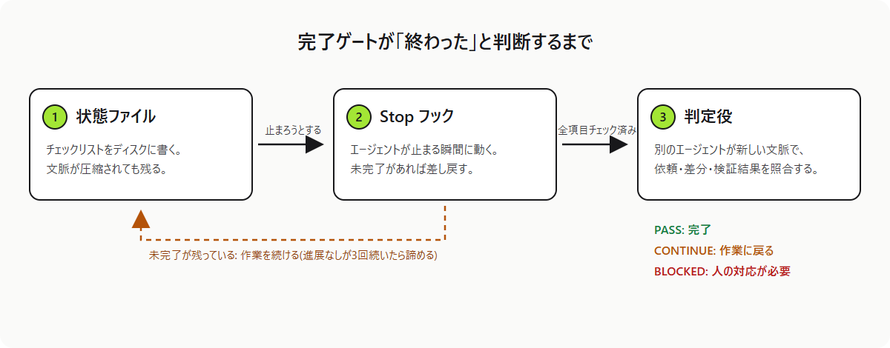
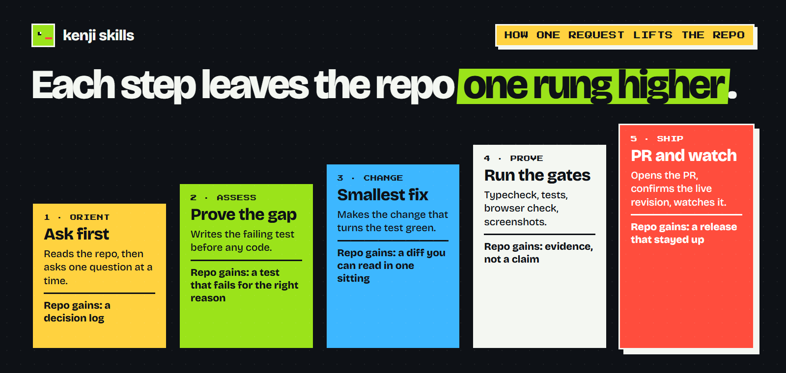
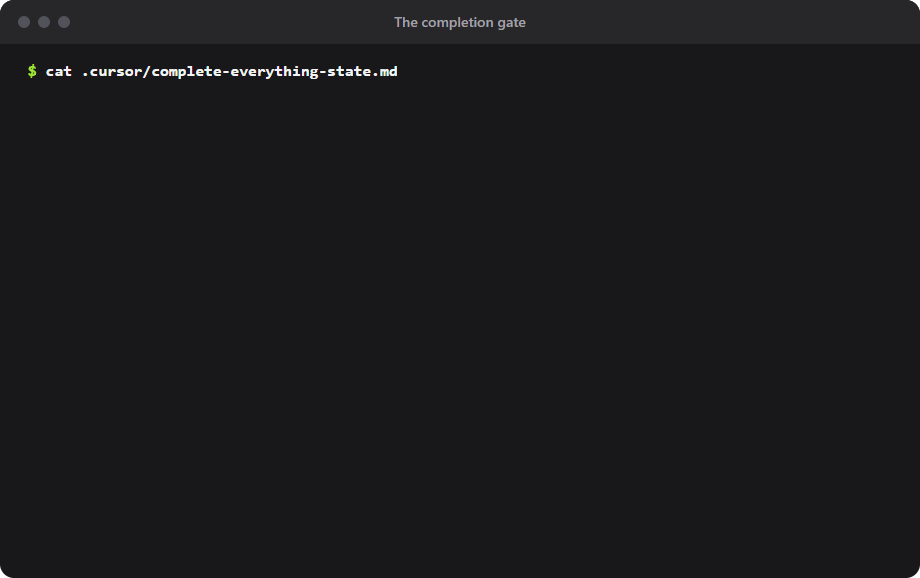
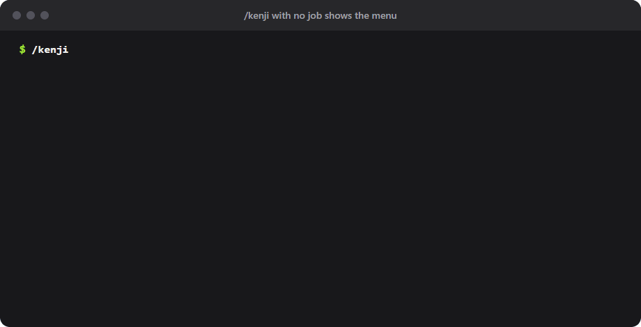
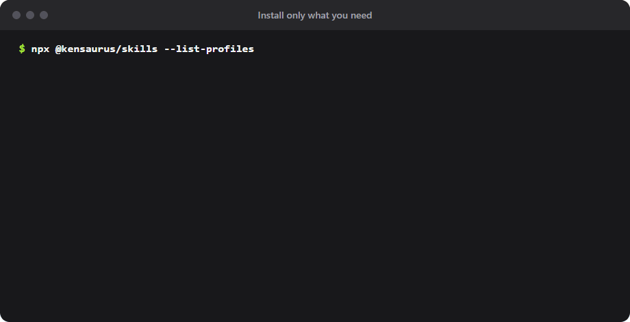

# AIエージェントの「完了しました」を信用しない仕組みを作った

> Zenn に載せる記事の原稿です。英語版は [completion-gate.md](completion-gate.md)、note 向けの短い版は [completion-gate.note.ja.md](completion-gate.note.ja.md)。

AIコーディングエージェントに作業を頼むと、「完了しました」と返ってきたのにテストが落ちていることがあります。チェックリストが半分残ったまま止まることもあります。

これを仕組みで止める「完了ゲート」を作りました。自作のスキル集 [kensaurus/skills](https://github.com/kensaurus/skills) に入っています。MIT ライセンスのオープンソースです。

この記事では次の順に書きます。

1. そもそも「スキル」とは何か
2. エージェントと働いていて困っていたこと
3. スキル集の全体像
4. 完了ゲートの作り方(本題)
5. ほかの有名なスキル集との違い
6. 導入方法と、まだできていないこと



## そもそも「スキル」とは

スキルは、エージェント向けの作業手順書です。実体は `SKILL.md` という Markdown ファイル1枚で、フォルダに入れて置くだけです。

```markdown
---
name: audit-security
description: Check security. OWASP-style findings with file and line, then fixes.
---

# 手順
1. まず認証まわりのコードを読む
2. 見つけた問題は、ファイル名と行番号つきで報告する
3. 根拠のない指摘は書かない
```

仕組みは2段階です。

- **説明文(description)は毎回読まれる。** エージェントは会話のたびに、入っているスキルの名前と説明文の一覧を受け取ります。
- **本文は必要なときだけ読まれる。** 依頼が説明文に合うと、エージェントはそのスキルの本文を読み込み、手順どおりに動きます。

つまり「セキュリティを確認して」と頼むだけで、`audit-security` の手順が動きます。スキル名を打つ必要はありません。

この形式は [Agent Skills](https://agentskills.io/specification) という公開仕様になっています。Claude Code、Cursor、Codex CLI、Gemini CLI、GitHub Copilot など、多くのエージェントが同じ `SKILL.md` を読めます。一度書けば、道具を変えても使い回せます。

プロンプト集との違いは、コピペが要らないことです。入れておけば、合う場面でエージェントが自分で使います。

## 困っていたこと

毎日エージェントと働いていて、同じ失敗を何度も見ました。

**1. 終わっていないのに「完了しました」と言う。**
差分がコンパイルできた時点で完了を宣言します。テストは実行していません。計画の後半は「今後の課題」として残されています。

**2. 聞かずに作り始める。**
「招待機能を作って」と頼むと、仕様の穴を自分で埋めて書き始めます。できあがるのは、頼んだものと少し違う機能です。

**3. テストより先にコードを書く。**
あとから書いたテストは、書いたコードに合わせたテストになります。壊れていても通ります。

**4. 根拠のない報告をする。**
「修正しました。動くはずです」と書きます。実行した結果ではありません。

**5. 直す前に確認しない。**
監査を頼んだだけなのに、勝手にコードを書き換えます。

どれも「プロンプトに一言書けば直る」ように見えます。実際には、長い作業になるほど守られなくなります。そこで、守ってほしい手順を1つずつスキルにしました。それを続けたら162個になりました。

## スキル集の全体像

どのスキルも、同じ5段のはしごを上ります。調べてから変える。証明してから出す。



| 段 | 動くスキルの例 | リポジトリに残るもの |
|:--|:--|:--|
| Orient(把握する) | `workflow-onboard`、`research` | 決定の記録 |
| Assess(調べる) | `audit-*`、`plan-*`、`workflow-grilling` | 失敗するテスト、または承認済みの計画 |
| Change(変える) | `design-*`、`enhance-*`、`backend-*` | 一度に読める大きさの差分 |
| Prove(証明する) | `test-*`、`complete-everything` | 主張ではなく証拠 |
| Ship(出す) | `workflow-ship-and-observe`、`deploy-*` | 出したあとも動いているリリース |

系統ごとの数は次のとおりです。

| 系統 | 数 | 何をするか |
|:--|--:|:--|
| `audit-*` | 32 | セキュリティ、UX、パフォーマンスなどを調べて、ファイルと行番号つきで報告する |
| `plan-*` | 23 | 調べて計画だけ書く。承認するまでコードは変えない |
| `enhance-*` | 23 | すでにある画面や機能を良くする |
| `workflow-*` | 22 | 機能追加、バグ修正、リリースなどを最初から最後まで通す |
| `design-*` | 10 | 新しい画面、API、メールなどを作る |
| `test-*` | 8 | 単体テスト、ブラウザでの確認、負荷試験、攻撃者視点の検査 |
| そのほか | 44 | バックエンド、モバイル、ドキュメント、後片付けなど |

先ほどの困りごとには、こう対応しています。

- **聞かずに作り始める** → `workflow-grilling` が、質問を1つずつ、おすすめの答えつきで出します。決めたことは記録に残り、承認してから実装に進みます。
- **テストより先にコードを書く** → `workflow-build-feature` は、仕様、失敗するテスト、最小の実装、動作確認、PR の順に進みます。
- **根拠のない報告** → 常時有効のルールが、完了の段階を「実装した → 範囲内で検証した → リポジトリ全体が通った → PR が通った → デプロイを確認した」に分けます。証拠のある段階までしか名乗れません。
- **直す前に確認しない** → `plan-*` の23個は、監査して計画を書くところで止まります。
- **終わっていないのに完了と言う** → これが本題の完了ゲートです。

## 完了ゲートの作り方

エージェントは、自分で「終わった」と判断したところで止まります。プロンプトに「最後までやり切ること」と書いても確実には効きません。Anthropic の Claude Fable 5.2 向けプロンプトガイドにも、低めの effort では作業を残したままターンを終えやすい、と書かれています。

文章で頼むのをやめて、止まる瞬間を外から検査することにしました。部品は3つです。

### 1. 状態ファイル

`complete-everything` スキルは、最初にチェックリストをファイルへ書き出します。場所は `.cursor/complete-everything-state.md` です。

```markdown
- [x] 招待リンクの発行APIを実装
- [x] 失敗するテストを先に書く
- [ ] 期限切れリンクのエラー表示
- [ ] 最後の編集のあとに型チェック・lint・テストを再実行
- [-] ビルド — n/a: このリポジトリにビルド手順がない
```

チェックリストをエージェントの記憶ではなくファイルに置く理由は2つあります。会話が長くなると、古い内容は圧縮されて消えます。ファイルは消えません。そして、ファイルなら外のプログラムから読めます。

`[-]`(対象外)には理由が必要です。理由のない `[-]` は未完了として数えます。「面倒な項目を対象外にして終わらせる」抜け道をふさぐためです。

### 2. Stop フック

Claude Code と Cursor には、エージェントが止まろうとしたときに動く Stop フックがあります。そこへ Node スクリプトを1本登録します。スクリプトは状態ファイルを読み、未チェックの項目があれば差し戻します。

下は実際の出力です(2026-11-17 に実行)。`agent` の行だけは説明用に足しました。



差し戻しが無限に続かないよう、条件を4つ入れています。

- 1項目も閉じないまま3回差し戻したら諦める
- 「誰々の承認待ち」と書かれた項目は数えない
- 24時間更新のない状態ファイルは無視する
- 状態ファイルがなければ何もしない

4つ目があるので、普段の会話には影響しません。ゲートが働くのは、`complete-everything` か `burndown-full` を走らせている間だけです。

作っていて分かったことがあります。回数の上限を会話ごとに数えないと、同じリポジトリで2つのエージェントが動いたとき、片方の編集がもう片方のカウンタを戻してしまいます。カウンタはリポジトリの外(`~/.cache/kenji/completion-gate/`)に、会話IDごとに置いています。

### 3. 判定役

チェックが全部ついても、まだ完了にしません。`completion-judge` というサブエージェントが、新しいコンテキストで次の4つを照合します。

- 元の依頼
- 状態ファイル
- 差分の全体
- 最後の編集のあとに取り直した検証結果

返すのは `PASS`、`CONTINUE`、`BLOCKED` のどれかです。根拠のない「たぶん通ります」は `CONTINUE` になります。

新しいコンテキストで動かすのは、作業した本人の思い込みを引き継がせないためです。本人は「ここは確認した」と覚えています。判定役は覚えていないので、証拠を探します。

## 実際に差し戻された例

このスキル集の v2.8.0 を出すとき、リリース用ブランチを判定役にかけました。CI は全部通っていました。結果は `CONTINUE` で、直す点が6つ返ってきました。

1つ紹介します。新しく入れた `/kenji` コマンドに `effort: low` を指定していました。Claude Code では、スキルの effort 指定は同じターンの残りにも効きます。そのため `/kenji` から呼ばれた実装用スキルまで低い effort で動く状態でした。テストでは見つからない不具合です。

ほかには、「あなたのスキルは決して消しません」という説明が実装と食い違っていた、という指摘もありました。削除の前にバックアップを取るよう、実装のほうを直しました。

6つとも直してからマージしました。経緯は [PR #54](https://github.com/kensaurus/skills/pull/54) にあります。

## スキル名を覚えなくていい

スキルが162個あると、「どれを使えばいいか覚えられない」という声が出ます。そこで `/kenji` を追加しました。

```
/kenji ログイン画面が一部のユーザーで壊れている
```

やりたいことを自分の言葉で書くと、合うスキルを1つ選んで実行します。候補が2つあるときだけ、質問を1つします。何も書かずに `/kenji` だけ打つと、メニューが出ます。



`/kenji` 自体は説明文の一覧に載せていません。使うまでトークンを消費しません。

## トークンの消費について

増えます。量は選べます。

エージェントは毎回、インストール済みスキルの説明文を1行ずつ読み込みます。全部入れると約39,000文字です。本文は、そのスキルが動くときだけ読み込まれます。

減らすにはプロファイルを指定します。`core` は毎日の流れに必要な約30個だけで、説明文は全体の5分の1以下です。



スキルが増えると、エージェントが似たスキルを取り違えやすくなるという研究もあります([Song & Wei, 2026](https://openreview.net/forum?id=RQuOPsCKnc))。202個のライブラリで成功率が最大21%下がった、という結果です。全部入れるのが正解とは限りません。

## ほかのスキル集との違い

有名なスキル集と比べます。数字は 2026-11-17 に各リポジトリと skills.sh で確認したものです。

| | スキル数 | GitHub スター | どれを使うかの決め方 |
|:--|--:|--:|:--|
| [mattpocock/skills](https://github.com/mattpocock/skills) | 56 | 32.6万 | `ask-matt` という案内役のスキル |
| [obra/superpowers](https://github.com/obra/superpowers) | 15 | 31.9万 | セッション開始時にフックが案内役を読み込む |
| [anthropics/skills](https://github.com/anthropics/skills) | 21 | 19.6万 | 2つのプラグインに分けて配布 |
| [garrytan/gstack](https://github.com/garrytan/gstack) | 77 | 14.2万 | `/office-hours` から始める |
| kensaurus/skills | 162 | 9 | `/kenji` と、プロファイルで絞る |

正直に書くと、利用者の数では比べものになりません。上の4つは少数精鋭で、覚えることが少ないのが強みです。superpowers は何も打たなくても案内役が働きます。

このスキル集の違いは3つです。

- **完了を外から検査する。** superpowers にも `verification-before-completion` というスキルがあり、「完了と言う前に検証コマンドを実行する」ことを求めます。考え方は同じです。違うのは、こちらはスキルの文章に加えて Stop フックで止まる瞬間を機械的に検査し、最後に別のエージェントが照合する点です。superpowers のフックは、セッション開始時のものだけでした(2026-11-17 に確認)。
- **範囲が広い。** 実装だけでなく、監査、計画、テスト、リリース、公開後の改善、集客まで入っています。その分、取り違えのリスクがあるので、プロファイルで絞れるようにしました。
- **インストーラが中身を見せる。** 書き込む前に全ファイルを一覧でき、書き込んだあとにハッシュで照合できます。

小さく始めたいなら superpowers や mattpocock/skills のほうが向いています。作業を最後まで通すための検査がほしいなら、こちらが役に立つと思います。併用もできます。インストーラは、ほかのスキルを消しません。

## インストール

Node.js 18 以上が必要です。

```bash
npx @kensaurus/skills --auto --dry-run   # 書き込まれるファイルを先に確認
npx @kensaurus/skills --auto             # 見つかったエージェントすべてに導入
npx @kensaurus/skills --auto --verify    # 導入したファイルをハッシュで照合
```

小さく入れる場合はこうです。

```bash
npx @kensaurus/skills --auto --profile core
```

他人が書いた指示をエージェントに読ませるのは、不安があると思います。そのために次のようにしています。

- インストーラは Node スクリプト1本で、依存パッケージがありません
- ネットワーク接続をせず、子プロセスも起動しません
- 書き込み先はホームディレクトリの下だけです
- 自分で作ったスキルは消しません
- スキルはすべて Markdown なので、入れる前に全部読めます

対応しているエージェントは次のとおりです。

| エージェント | 入るもの |
|:--|:--|
| Claude Code | スキル、コマンド、サブエージェント、ルール、完了ゲート |
| Cursor | スキル、コマンド、サブエージェント、ルール、完了ゲート |
| Codex CLI、Gemini CLI | スキルとルール |
| そのほか `SKILL.md` を読めるもの | `npx skills add kensaurus/skills` でスキルのみ |

## どこで使っているか

このスキル集は、[kensaurus](https://kensaur.us/) の制作物を作る中で書き足してきたものです。

- [yen-yen](https://kensaur.us/yen-yen/): 銀行ログイン不要、ふたりでつける家計簿
- [glot.it](https://kensaur.us/glot-it/): AIの先生と話せる、タイ語学習アプリ
- [Mushi Mushi](https://kensaur.us/mushi-mushi/): AIで作ったアプリが壊れた理由を説明し、直し方をエディタに渡す。[ソースは GitHub](https://github.com/kensaurus/mushi-mushi) にあります
- [一人社長](https://solo-boss.kensaur.us/): 一人会社の帳簿づけから、決算・申告まで
- [嬬恋牧場Work&Camp](https://tsumagoi.kensaur.us/): 自分たちで運営する、山の24時間ラウンジ
- [help her take photo](https://kensaur.us/help-her-take-photo/): 2台のスマホで、撮られる人が写真を指示できる
- [lets-talk](https://talk.kensaur.us/): 言いにくい会話を、AIコーチと練習

React、Next.js、Supabase、React Native、Capacitor の案件が中心なので、スキルもその構成に寄っています。Mushi Mushi と組み合わせるための `mushi-*` スキルも2つ入っています。

スキル集そのものの紹介は、kensaurus のサイトにもあります: [kenji skills のノート](https://kensaur.us/notes/kenji-skills/)。全制作物の一覧は [kensaur.us](https://kensaur.us/) にあります。

## まだできていないこと

- **効果を示す数字がありません。** 正しいスキルが呼ばれるかを確かめる評価ケースを12個用意しましたが、実行したのは1個です。「ゲートで完了率が何%上がった」と言えるデータは、これから取ります。
- **スキルは私の使い方に寄っています。** 大半はほかの構成でも動きますが、合わないものもあります。
- **ゲートが働くのは Claude Code と Cursor だけです。** Codex CLI と Gemini CLI ではスキルは使えますが、Stop フックがありません。
- **162個は多すぎるかもしれません。** 先ほどの研究のとおり、数が増えると取り違えも増えます。評価の結果を見て、自動で動くスキルを減らすことも考えています。

## 同じものを自分で作るには

スキル集を丸ごと入れなくても、完了ゲートだけ真似できます。読むファイルは2つです。

- [hooks/completion-gate.mjs](https://github.com/kensaurus/skills/blob/main/hooks/completion-gate.mjs): Stop フックの本体。約250行で、依存はありません
- [agents/completion-judge.md](https://github.com/kensaurus/skills/blob/main/agents/completion-judge.md): 判定役の定義

手順は次のとおりです。

1. 作業の最初に、チェックリストをファイルへ書かせる
2. Stop フックでそのファイルを読み、未完了があれば差し戻す
3. 差し戻しの回数に上限をつける
4. 最後に、別のコンテキストのエージェントに証拠を照合させる

## リンク

- リポジトリ: https://github.com/kensaurus/skills
- はじめての方向けの説明: https://github.com/kensaurus/skills/blob/main/docs/GETTING-STARTED.md
- スキルの一覧: https://github.com/kensaurus/skills/blob/main/docs/SKILLS.md
- skills.sh のページ: https://www.skills.sh/kensaurus/skills
- 英語版の記事: https://github.com/kensaurus/skills/blob/main/docs/articles/completion-gate.md
- kensaurus のほかの制作物: https://kensaur.us/

合わなかった点は [Issue](https://github.com/kensaurus/skills/issues) で教えてください。
