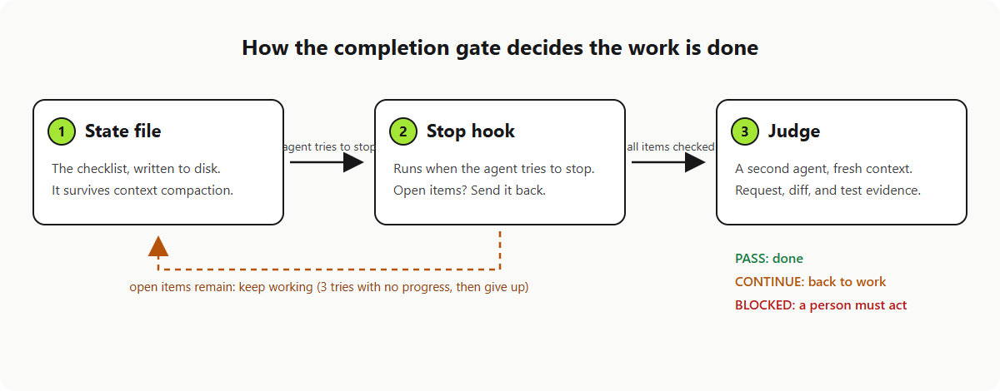
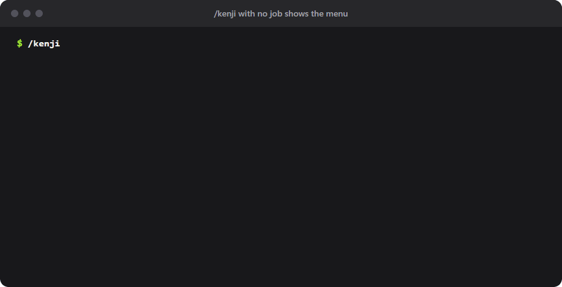

# A gate that does not take the agent's word for "done"

> Japanese version: [completion-gate.ja.md](completion-gate.ja.md).

A coding agent says the work is complete. The tests fail, or half the checklist is still open.

I built a completion gate to stop that. It ships in my skills pack, [kensaurus/skills](https://github.com/kensaurus/skills) (MIT), and runs in Claude Code and Cursor.



## The problem

An agent stops when it decides it has finished. Its evidence is usually that the diff compiles.

Writing "finish the whole task" in the prompt does not fix this reliably. Anthropic's prompting guide for Claude Fable 5.2 says the model ends turns with work still owed more often at lower effort.

So the gate does not ask. It checks the moment the agent tries to stop.

## Three parts

### 1. A state file

The `complete-everything` skill writes the checklist to `.cursor/complete-everything-state.md` before it starts.

```markdown
- [x] Invite link API
- [x] Failing test written first
- [ ] Error message for an expired link
- [ ] Re-run typecheck, lint and tests after the last edit
- [-] Build — n/a: this repository has no build step
```

The file survives context compaction. A `[-]` (not applicable) line needs a reason; without one it counts as open.

### 2. A Stop hook

Claude Code and Cursor run a Stop hook when the agent tries to end its turn. The gate is one Node script registered there. It reads the state file and, if items are open, sends the agent back with the list.

This is real output, run on 2026-11-17. Only the `agent` line was added for the example.


Four conditions keep it from looping forever:

- It gives up after three follow-ups in which no item closes.
- An item marked `blocked by: <who>` does not count.
- A state file nobody has touched for 24 hours is ignored.
- With no state file, it does nothing.

The last one means ordinary sessions never see the gate.

### 3. A judge

Checked boxes are still not enough. A subagent named `completion-judge` starts with a fresh context and compares four things:

- the original request
- the state file
- the full diff
- verification results taken after the last edit

It returns `PASS`, `CONTINUE`, or `BLOCKED`. A claim with no evidence behind it gets `CONTINUE`.

## One time it said no

Before releasing v2.8.0 of the pack, I ran the release branch through the judge. CI was green. The verdict was `CONTINUE`, with six things to fix.

One of them: the new `/kenji` command set `effort: low`. In Claude Code, a skill's effort applies for the rest of the turn. So the implementation skill that `/kenji` started would also have run at low effort. No test would have caught that.

I fixed all six before merging. The record is in [PR #54](https://github.com/kensaurus/skills/pull/54).

## No names to memorize

The pack has 162 skills, and people told me they could not remember which one to use. So there is now one command:

```
/kenji the login page is broken for some users
```

You write the job in your own words. It picks one skill and runs it. If two fit, it asks one question first. With no job, it shows a menu.



## What it costs in tokens

It costs some, and you choose how much.

The agent reads a one-line description of every installed skill in each session. For the full pack that is about 39,000 characters. A skill's body loads only when the skill runs.

To pay less, install a profile. `core` is 31 skills and about 7,200 characters.


A larger library also makes the agent more likely to pick a near-miss. One study measured pass rates falling by up to 21% at a 202-skill library ([Song & Wei, 2026](https://openreview.net/forum?id=RQuOPsCKnc)).

## Install

You need Node.js 18 or newer.

```bash
npx @kensaurus/skills --auto --dry-run   # list every file it would write
npx @kensaurus/skills --auto             # install for each agent it finds
npx @kensaurus/skills --auto --verify    # hash-check every installed file
```

The installer is one Node script with no dependencies. It opens no network connection and writes only under your home directory. It never deletes skills you wrote yourself.

## What is not done

- **I have no number for the effect.** There are twelve eval cases that check whether the right skill loads. I have run one.
- **The skills lean toward how I work.** Most were written on React, Next.js, and Supabase projects.
- **The gate works only in Claude Code and Cursor.** Codex CLI and Gemini CLI can use the skills, but they have no Stop hook.

## Build your own

Two files hold the whole mechanism:

- [hooks/completion-gate.mjs](../../hooks/completion-gate.mjs): the Stop hook
- [agents/completion-judge.md](../../agents/completion-judge.md): the judge

If something does not fit how you work, open an [issue](https://github.com/kensaurus/skills/issues).
