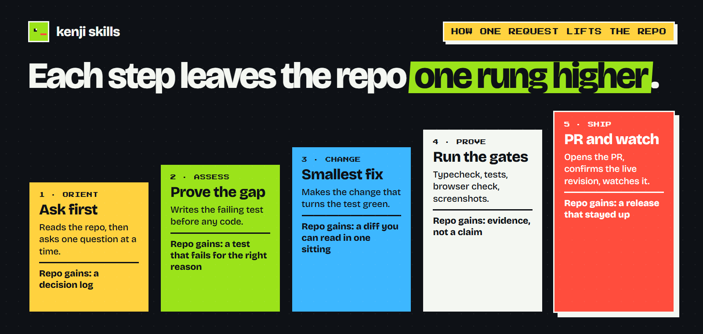
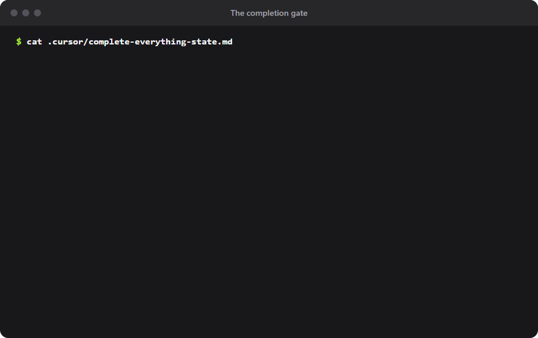
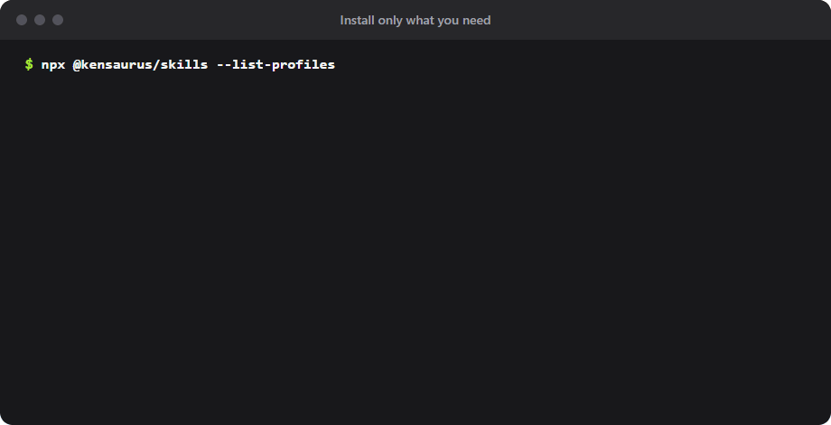

# A gate that does not take the agent's word for "done"

> Japanese version: [completion-gate.ja.md](completion-gate.ja.md).

A coding agent says the work is complete. The tests fail, or half the checklist is still open.

I built a completion gate to stop that. It ships in my skills pack, [kensaurus/skills](https://github.com/kensaurus/skills), which is open source under the MIT license.

This article covers six things, in this order:

1. What a "skill" is
2. The problems I kept hitting with coding agents
3. What is in the pack
4. How the completion gate works (the main part)
5. How the pack differs from the well-known skill packs
6. How to install it, and what is not done yet


## What a skill is

A skill is a written procedure for an agent. It is one Markdown file, `SKILL.md`, in a folder of its own.

```markdown
---
name: audit-security
description: Check security. OWASP-style findings with file and line, then fixes.
---

# Steps
1. Read the authentication code first.
2. Report each problem with its file and line number.
3. Do not report a finding you cannot show.
```

Skills work in two stages:

- **The description is read every time.** In each session, the agent receives the name and description of every installed skill.
- **The body is read only when needed.** When a request matches a description, the agent loads that skill's body and follows it.

So you say "check this app's security", and the `audit-security` procedure runs. You do not type the skill's name.

The format is a public specification, [Agent Skills](https://agentskills.io/specification). Claude Code, Cursor, Codex CLI, Gemini CLI, GitHub Copilot, and many other agents read the same `SKILL.md` files. You write a skill once and keep it when you change tools.

This is different from a prompt library. You do not copy and paste anything. Once a skill is installed, the agent uses it when the situation fits.

## The problems

I work with coding agents every day, and I saw the same failures again and again.

**1. It says "done" when it is not done.**
The agent declares the work complete as soon as the diff compiles. It has not run the tests. The second half of the plan is listed as "future work".

**2. It starts building without asking.**
Ask for an invite feature, and the agent fills the gaps in the spec on its own and starts writing. You get a feature that is close to what you asked for, but not quite.

**3. It writes the code before the test.**
A test written after the code is shaped to fit the code. It passes even when the code is wrong.

**4. It reports without evidence.**
"Fixed. This should work now." That sentence is a guess, not the result of a run.

**5. It changes code before you agree.**
You asked for an audit, and it rewrote the module.

Each of these looks like something one line in the prompt would fix. In practice, the longer the task, the less the line is followed. So I turned each procedure I wanted the agent to keep into a skill. After a while there were 162 of them.

## What is in the pack

Every skill climbs the same five rungs. Assess before you change. Prove before you ship.



| Rung | Skills that run | What the repository gains |
|:--|:--|:--|
| Orient | `workflow-onboard`, `research` | A decision log |
| Assess | `audit-*`, `plan-*`, `workflow-grilling` | A failing test, or a plan you approved |
| Change | `design-*`, `enhance-*`, `backend-*` | A diff you can read in one sitting |
| Prove | `test-*`, `complete-everything` | Evidence, not a claim |
| Ship | `workflow-ship-and-observe`, `deploy-*` | A release that stayed up |

By family:

| Family | Count | What it does |
|:--|--:|:--|
| `audit-*` | 32 | Inspect security, UX, performance, and more; report each finding with a file and line |
| `plan-*` | 23 | Inspect and write a plan only; no code changes until you approve |
| `enhance-*` | 23 | Improve a page or feature that already exists |
| `workflow-*` | 22 | Take a feature, a fix, or a release from start to finish |
| `design-*` | 10 | Build a new page, API, email, or theme |
| `test-*` | 8 | Unit tests, browser checks, load tests, attacker-minded testing |
| Others | 44 | Backend, mobile, docs, cleanup, and more |

Here is how the pack answers the problems above:

- **Starting without asking** → `workflow-grilling` asks one question at a time, each with a recommended answer. The decisions go into a log, and you approve the log before any code is written.
- **Code before the test** → `workflow-build-feature` goes spec, failing test, smallest change, smoke test, pull request, in that order.
- **Reports without evidence** → an always-on rule splits "done" into rungs: implemented, verified in scope, repository green, pull request green, deployed and verified. The agent may claim only the rung it has evidence for.
- **Changing code before you agree** → the 23 `plan-*` skills stop after the audit and the plan.
- **Saying "done" when it is not** → that is the completion gate, below.

## How the completion gate works

An agent stops when it decides it has finished. Writing "finish the whole task" in the prompt does not fix this reliably. Anthropic's prompting guide for Claude Fable 5.2 says the model ends turns with work still owed more often at lower effort levels.

So the gate does not ask. It checks the moment the agent tries to stop. It has three parts.

### 1. A state file

The `complete-everything` skill writes the checklist to `.cursor/complete-everything-state.md` before it starts.

```markdown
- [x] Invite link API
- [x] Failing test written first
- [ ] Error message for an expired link
- [ ] Re-run typecheck, lint and tests after the last edit
- [-] Build — n/a: this repository has no build step
```

There are two reasons to keep the checklist in a file and not in the agent's memory. In a long session, older context is compacted and lost; a file stays. And a file can be read by a program outside the agent.

A `[-]` (not applicable) line needs a reason. Without one, it counts as open. This closes the shortcut of marking the hard item "not applicable" to finish early.

### 2. A Stop hook

Claude Code and Cursor run a Stop hook when the agent tries to end its turn. The gate is one Node script registered there. It reads the state file and, if items are open, sends the agent back with the list.

This is real output, run on 2026-11-17. Only the `agent` line was added for the example.



Four conditions keep it from looping forever:

- It gives up after three follow-ups in which no item closes.
- An item marked `blocked by: <who>` does not count.
- A state file nobody has touched for 24 hours is ignored.
- With no state file, it does nothing.

The last one means ordinary sessions never see the gate. It works only while `complete-everything` or `burndown-full` is running.

One thing I learned while building it: the retry limit has to be counted per conversation. When two agents worked in the same repository with a shared counter, one agent's edits reset the other's count. The counters now live outside the repository, in `~/.cache/kenji/completion-gate/`, one per conversation.

### 3. A judge

Checked boxes are still not enough. A subagent named `completion-judge` starts with a fresh context and compares four things:

- the original request
- the state file
- the full diff
- verification results taken after the last edit

It returns `PASS`, `CONTINUE`, or `BLOCKED`. A claim with no evidence behind it gets `CONTINUE`.

The fresh context matters. The agent that did the work remembers checking things. The judge does not, so it looks for the evidence.

## One time it said no

Before releasing v2.8.0 of the pack, I ran the release branch through the judge. CI was green. The verdict was `CONTINUE`, with six things to fix.

One of them: the new `/kenji` command set `effort: low`. In Claude Code, a skill's effort applies for the rest of the turn. So the implementation skill that `/kenji` started would also have run at low effort. No test would have caught that.

Another: the docs promised the installer "never deletes your own skills", and one code path could. I changed the code to take a backup first.

I fixed all six before merging. The record is in [PR #54](https://github.com/kensaurus/skills/pull/54).

## No names to memorize

With 162 skills, people told me they could not remember which one to use. So there is now one command to remember:

```
/kenji the login page is broken for some users
```

You write the job in your own words. It picks one skill and runs it. If two fit, it asks one question first. With no job, it shows a menu.


`/kenji` itself is not in the description listing, so it costs no tokens until you use it.

## What it costs in tokens

It costs some, and you choose how much.

The agent reads a one-line description of every installed skill in each session. For the full pack that is about 39,000 characters. A skill's body loads only when the skill runs.

To pay less, install a profile. `core` is 31 skills for the daily loop, with a listing of about 7,200 characters.



A larger library also makes the agent more likely to pick a near-miss. One study measured pass rates falling by up to 21% at a 202-skill library ([Song & Wei, 2026](https://openreview.net/forum?id=RQuOPsCKnc)). Installing everything is not always the right choice.

## How it differs from other skill packs

Here are the best-known packs. The numbers were checked on each repository and on skills.sh on 2026-11-17.

| | Skills | GitHub stars | How you pick a skill |
|:--|--:|--:|:--|
| [mattpocock/skills](https://github.com/mattpocock/skills) | 56 | 326K | An `ask-matt` router skill |
| [obra/superpowers](https://github.com/obra/superpowers) | 15 | 319K | A hook loads a guide skill at session start |
| [anthropics/skills](https://github.com/anthropics/skills) | 21 | 196K | Two plugin bundles |
| [garrytan/gstack](https://github.com/garrytan/gstack) | 77 | 142K | Start with `/office-hours` |
| kensaurus/skills | 162 | 9 | `/kenji`, and profiles to narrow it down |

To be honest, the user numbers are not comparable. The four above are small and focused, and you have little to remember. superpowers works without your typing anything.

This pack differs in three ways:

- **It checks "done" from outside.** superpowers also has a `verification-before-completion` skill that asks the agent to run verification before claiming success. The idea is the same. The difference is that this pack adds a Stop hook that checks the moment of stopping mechanically, and a second agent that compares the evidence at the end. superpowers' hook config registers only a session-start hook (checked 2026-11-17).
- **It covers more ground.** Besides building, it has audits, plans, tests, releases, post-launch loops, and go-to-market work. That breadth raises the risk of picking the wrong skill, which is why profiles exist.
- **The installer shows its work.** It lists every file before writing and hash-checks every file after.

If you want to start small, superpowers or mattpocock/skills may suit you better. If you want a check that holds the agent to finishing, this pack may help. You can use both; the installer never removes other skills.

## Install

You need Node.js 18 or newer.

```bash
npx @kensaurus/skills --auto --dry-run   # list every file it would write
npx @kensaurus/skills --auto             # install for each agent it finds
npx @kensaurus/skills --auto --verify    # hash-check every installed file
```

For a smaller install:

```bash
npx @kensaurus/skills --auto --profile core
```

Letting someone else's instructions steer your agent is a fair worry. This is what the pack does about it:

- The installer is one Node script with no dependencies.
- It opens no network connection and starts no child processes.
- It writes only under your home directory.
- It never deletes skills you wrote yourself.
- Every skill is plain Markdown, so you can read all of it before installing.

Supported agents:

| Agent | What it gets |
|:--|:--|
| Claude Code | Skills, commands, subagents, rules, the completion gate |
| Cursor | Skills, commands, subagents, rules, the completion gate |
| Codex CLI, Gemini CLI | Skills and rules |
| Any other agent that reads `SKILL.md` | Skills only, with `npx skills add kensaurus/skills` |

## Where it is used

The pack grew out of building the apps at [kensaurus](https://kensaur.us/):

- [yen-yen](https://kensaur.us/yen-yen/): a shared household money book, no bank login
- [glot.it](https://kensaur.us/glot-it/): a Thai learning app with an AI tutor
- [Mushi Mushi](https://kensaur.us/mushi-mushi/): tells you why your AI-built app broke, and hands the fix to your editor ([source on GitHub](https://github.com/kensaurus/mushi-mushi))
- [Solo Boss](https://solo-boss.kensaur.us/): bookkeeping through to tax filing, for one-person companies
- [Tsumagoi Work&Camp](https://tsumagoi.kensaur.us/): a 24-hour mountain lounge, run by us
- [help her take photo](https://kensaur.us/help-her-take-photo/) and [lets-talk](https://talk.kensaur.us/): two of the mobile apps

Most of that work is React, Next.js, Supabase, React Native, and Capacitor, so the skills lean that way. Two `mushi-*` skills connect the pack to Mushi Mushi.

The pack also has a page on the kensaurus site: [the kenji skills note](https://kensaur.us/notes/kenji-skills/en/). Every app is listed at [kensaur.us](https://kensaur.us/).

## What is not done

- **I have no number for the effect.** There are twelve eval cases that check whether the right skill loads. I have run one. Numbers on whether the gate raises completion rates are still to come.
- **The skills lean toward how I work.** Most work on other stacks, but some will not fit.
- **The gate works only in Claude Code and Cursor.** Codex CLI and Gemini CLI can use the skills, but they have no Stop hook.
- **162 may be too many.** As the study above shows, more skills mean more mix-ups. Depending on the eval results, I may reduce the number of skills that trigger on their own.

## Build your own

You can copy the gate without installing the pack. Two files hold the whole mechanism:

- [hooks/completion-gate.mjs](../../hooks/completion-gate.mjs): the Stop hook, about 250 lines, no dependencies
- [agents/completion-judge.md](../../agents/completion-judge.md): the judge

The recipe:

1. Have the agent write the checklist to a file at the start.
2. In a Stop hook, read that file and send the agent back while items are open.
3. Cap the number of follow-ups.
4. At the end, have an agent with a fresh context compare the evidence.

## Links

- Repository: https://github.com/kensaurus/skills
- First-time guide: https://github.com/kensaurus/skills/blob/main/docs/GETTING-STARTED.md
- Every skill, one line each: https://github.com/kensaurus/skills/blob/main/docs/SKILLS.md
- skills.sh page: https://www.skills.sh/kensaurus/skills
- Japanese version of this article: [completion-gate.ja.md](completion-gate.ja.md)
- Other kensaurus apps: https://kensaur.us/

If something does not fit how you work, open an [issue](https://github.com/kensaurus/skills/issues).
