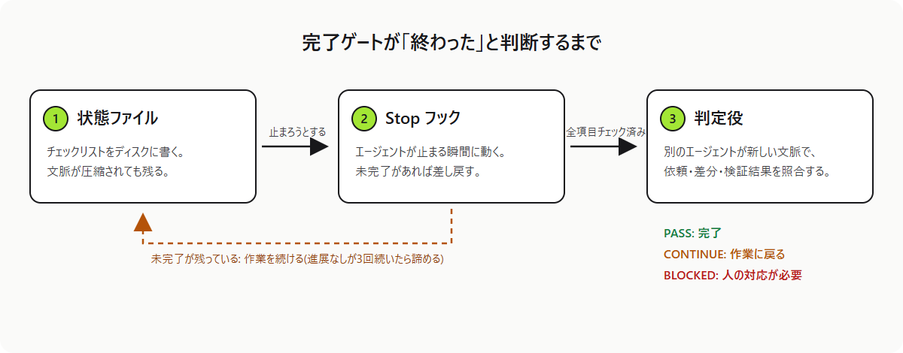
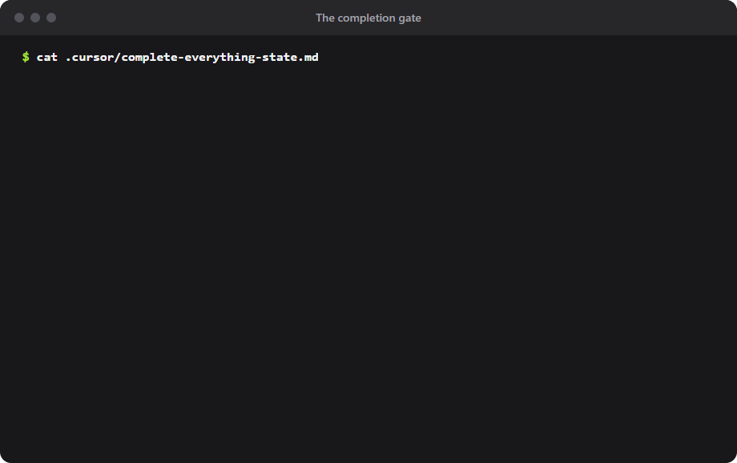
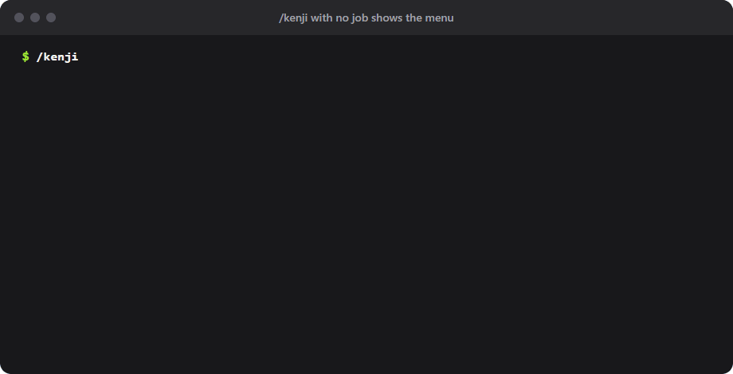

# AIの「完了しました」を、仕組みで確かめるようにした話

> note 向けの版です。技術的な版は [completion-gate.ja.md](completion-gate.ja.md)。

AIに「完了しました」と言われたのに、終わっていなかった。そんな経験はありませんか。

私は群馬の山の中で、ひとりでアプリを作っています。家計簿の yen-yen、タイ語学習の glot.it、ひとり会社向けの会計ソフトの一人社長などです。作業の多くは、Claude Code や Cursor といったAIのコーディング助手と一緒に進めています。

便利です。ただ、ひとつ困ることがありました。頼んだ作業が半分残っているのに、AIが「できました」と言って止まってしまうのです。

「最後までやってください」と書き足しても、あまり変わりませんでした。そこで、お願いするのをやめて、仕組みで止めることにしました。この記事では、その仕組みと、それを含む道具箱を紹介します。

## AIの助手が、どこでつまずくか

毎日いっしょに働いていると、同じつまずきを何度も見ます。

- **終わっていないのに「完了しました」と言う。** 書いたプログラムが動くかどうかを確かめる前に、完了を宣言します。
- **聞かずに作り始める。** 「招待機能を作って」と頼むと、決まっていない部分を自分で想像して作り始めます。頼んだものと少し違うものができあがります。
- **確かめていないのに「動くはずです」と言う。** 実際に試した結果ではなく、予想を報告します。
- **見てほしいだけなのに、直してしまう。** 点検を頼んだだけなのに、勝手に書き換えます。

人間の職場にたとえると、優秀だけれど、報告がちょっと楽観的な新人です。能力はあります。足りないのは、仕事の進め方の型です。

## 型を「手順書」にして渡す

そこで、仕事の進め方を1つずつ手順書にして、AIに渡すことにしました。AIの世界では、この手順書を「スキル」と呼びます。

スキルの中身は、ふつうの文章で書いたメモ1枚です。たとえば「セキュリティを点検するときは、問題をファイル名と行番号つきで報告する。根拠のない指摘は書かない」といった具合です。

便利なのは、使うときに名前を覚えていなくていいことです。AIは入っているスキルの一覧を毎回読んでいて、「セキュリティを見て」と頼まれると、合う手順書を自分で開きます。

この形式は公開された共通の決まりになっていて、Claude Code、Cursor、GitHub Copilot など多くのAI助手が同じ手順書を読めます。道具を変えても、手順書はそのまま使えます。

そうやって手順書を書きためていったら、162個になりました。新しい機能を作る、バグを直す、セキュリティを点検する、テストを書く、公開する、公開後に改善する、集客する。ひととおりの仕事が入っています。

## 本題:「完了しました」を確かめる仕組み

手順書を渡しても、ひとつだけ直らないことがありました。長い作業になると、AIは途中で「完了しました」と言って止まります。

AIを作っている Anthropic 社の公式ガイドにも、最新のモデルは考える量を控えめに設定すると作業を残したまま止まりやすい、と書かれています。お願いの文章だけでは防ぎきれない、ということです。

そこで「完了ゲート」を作りました。やっていることは3つです。



**1. やることリストをファイルに書き出す。**
作業の最初に、AIにやることリストを作らせて、ファイルに保存させます。AIの記憶ではなくファイルに残すのがポイントです。長い会話の途中で、AIは前のほうの内容を忘れていきます。ファイルは忘れません。

**2. AIが止まろうとした瞬間にリストを確認する。**
AIの助手には、作業を終えようとした瞬間に、決まったプログラムを動かす仕組みがあります。そこでリストを読み、まだ残っている項目があれば「これが残っています」と言って作業に戻します。

ただし、何度戻しても進まないときは、3回であきらめます。「〇〇さんの返事待ち」と書かれた項目も数えません。終わらない作業に、AIを閉じ込めないためです。

**3. 別のAIに検査させる。**
リストが全部埋まっても、まだ完了にはしません。作業した本人とは別のAIが、頼んだ内容、実際に変わった部分、テストの結果を見比べて、「合格」「まだ」「人の判断が必要」のどれかを返します。

別のAIにするのには理由があります。作業した本人は「ここは確かめた」と覚えています。別のAIは覚えていないので、証拠を探します。

人間の仕事でいえば、「作業者の自己申告ではなく、チェックリストと第三者の検査で完了を決める」というだけの話です。工場や建設現場では当たり前のことを、AIの仕事にも持ち込みました。

下は、実際にこの仕組みが動いたときの画面です。リストに2つ残っている状態でAIが「完了しました」と言うと、仕組みが止めて、残りの2つを示します。両方終わると、止まってよいと返します。



## 実際に効いた場面

この道具箱の新しい版を公開するとき、検査役のAIにかけてみました。自動テストは全部通っていました。私は公開する気でいました。

それでも検査役は「まだです」と返し、直すべき点を6つ挙げました。

そのうちのひとつは、こういうものでした。新しく追加した機能のせいで、ほかの手順書が「手を抜いたモード」で動いてしまう状態になっていたのです。テストでは見つからない種類の問題でした。

ほかにも、説明書に「あなたの手順書は決して消しません」と書いてあるのに、消してしまう場合がある、という指摘もありました。説明書を直すのではなく、消す前に必ず控えを取るように仕組みのほうを直しました。

6つとも直してから公開しました。自分の作った仕組みに、自分の見落としを止めてもらった形です。

## 合言葉はひとつだけ

手順書が162個もあると、どれを使えばいいか分からなくなります。実際に「覚えられない」という声もいただきました。

そこで、合言葉をひとつだけ用意しました。

```
/kenji ログイン画面が一部のユーザーで壊れている
```

`/kenji` のあとに、やりたいことを自分の言葉で書きます。AIが合う手順書を1つ選び、何をするかを1行で伝えてから、そのまま実行します。候補が2つあるときだけ、質問を1つします。

何も書かずに `/kenji` とだけ打つと、メニューが出ます。



## 全部入れなくていい

手順書が多いと、AIが毎回読む一覧も長くなります。そのぶん利用料がかかり、似た手順書を取り違えることも増えます。202個の手順書を入れると成功率が最大21%下がった、という研究もあります。

そこで、よく使う約30個だけを入れる「core」という組み合わせを用意しました。ウェブ画面、サーバー、スマホアプリ、集客、保守、と必要に応じて足せます。

## ほかの道具箱との違い

AIの手順書集は、ほかにも有名なものがいくつもあります。利用者数では、私のものは比べものになりません。少数精鋭で、覚えることが少ないものが人気です。

それでも作り続けているのは、「完了したかどうかを、AIの自己申告ではなく外から確かめる」部分が、自分の仕事に欠かせないからです。似た考え方の手順書はほかにもありますが、止まる瞬間を機械的に確かめ、最後に別のAIが照合するところまで組み込んだものは、私が調べた範囲では見つかりませんでした。

ほかの道具箱と一緒に使うこともできます。入れるときに、ほかの手順書は消しません。

## 正直なところ

- 「これで完了率が何%上がった」という数字は、まだありません。これから測ります。
- 手順書は私の仕事のやり方に寄っています。合わない人もいると思います。
- 完了ゲートが働くのは、Claude Code と Cursor の2つだけです。
- 無料で、オープンソースです。中身はすべて普通の文章なので、入れる前に全部読めます。

## つくった人と、ほかの制作物

kensaurus という名前で、アプリやサービスを作っています。この道具箱は、次のようなものを作る中で育ってきました。

- [yen-yen](https://kensaur.us/yen-yen/): 銀行ログイン不要、ふたりでつける家計簿
- [glot.it](https://kensaur.us/glot-it/): AIの先生と話せる、タイ語学習アプリ
- [一人社長](https://solo-boss.kensaur.us/): 一人会社の帳簿づけから、決算・申告まで
- [Mushi Mushi](https://kensaur.us/mushi-mushi/): AIで作ったアプリが壊れた理由を説明し、直し方を渡す
- [嬬恋牧場Work&Camp](https://tsumagoi.kensaur.us/): 自分たちで運営する、山の24時間ラウンジ

全部の一覧は [kensaur.us](https://kensaur.us/) にあります。

## リンク

- 道具箱の本体: https://github.com/kensaurus/skills
- はじめての方向けの説明: https://github.com/kensaurus/skills/blob/main/docs/GETTING-STARTED.md
- kensaurus のサイトでの紹介: https://kensaur.us/notes/kenji-skills/

技術的な詳しい話は Zenn に書きました。
